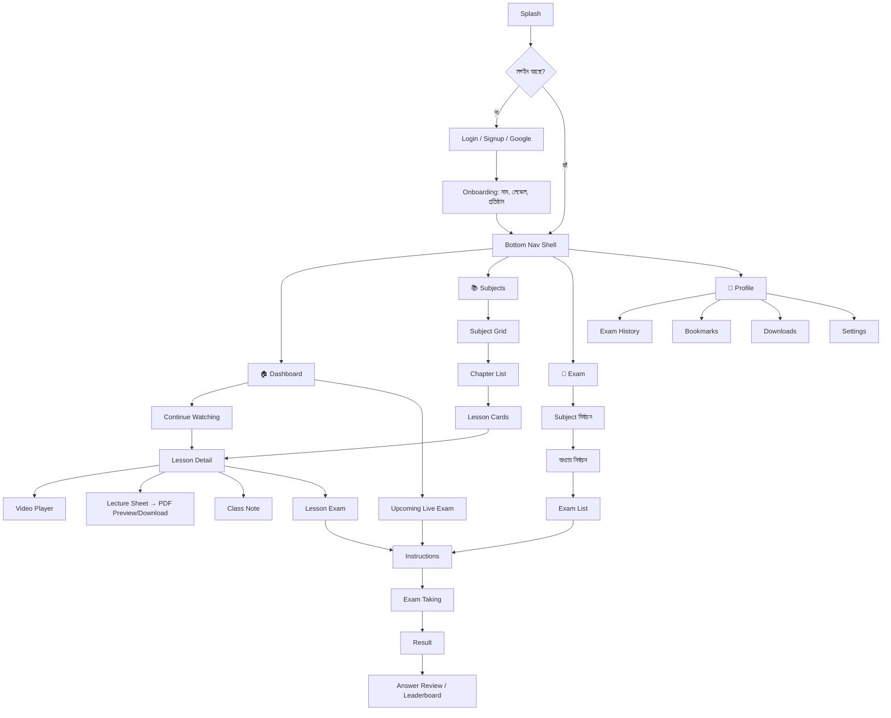
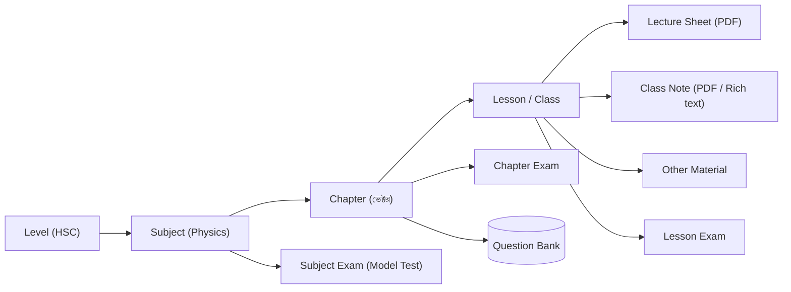
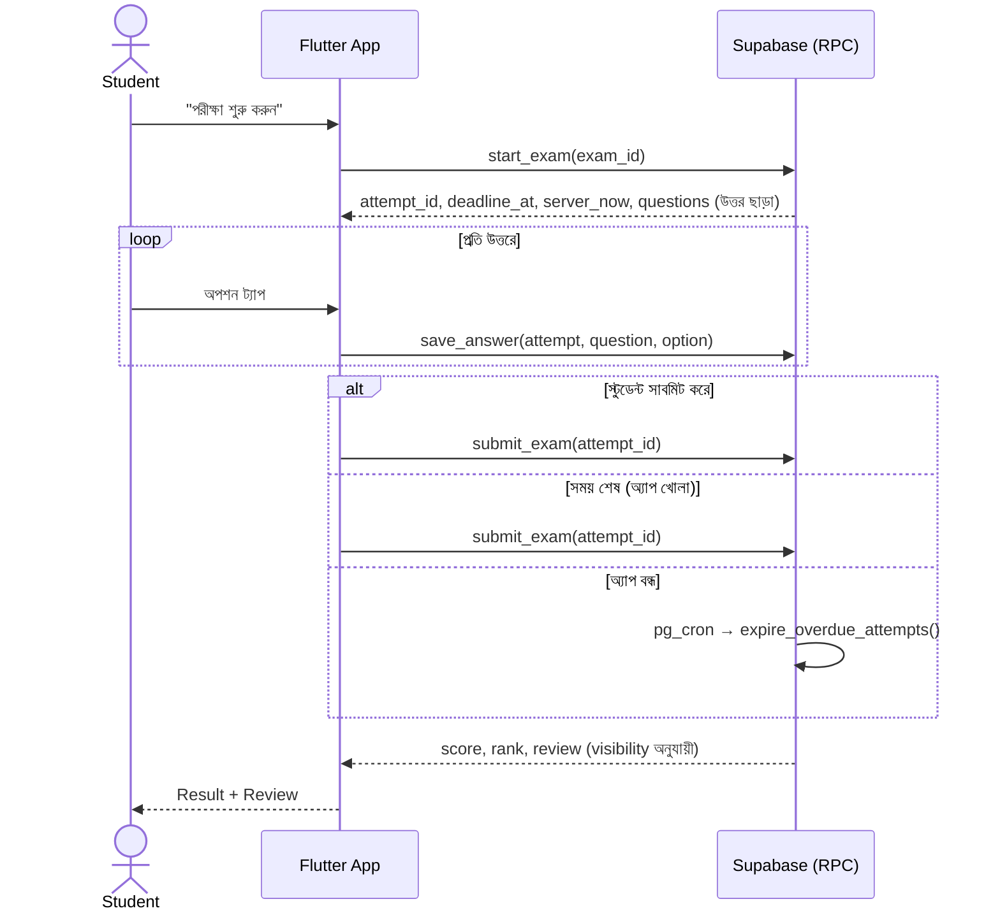

# 01 — Product Requirements Document (PRD)

| | |
|---|---|
| **প্রোডাক্ট** | ClassRoom — স্টুডেন্ট লার্নিং ও এক্সাম প্ল্যাটফর্ম |
| **ভার্সন** | 1.0 (MVP) |
| **প্ল্যাটফর্ম** | Android/iOS অ্যাপ (Flutter) — শুধু স্টুডেন্ট · Admin Website (Next.js) · Backend (Supabase) |
| **ভাষা** | বাংলা (প্রধান), English (টগল) |
| **স্ট্যাটাস** | Approved for build |

---

## ১. প্রোডাক্ট ভিশন

> **"একটা অ্যাপেই ক্লাস, নোট আর পরীক্ষা: বাংলাদেশের স্টুডেন্টদের জন্য সাজানো-গোছানো, দ্রুত আর সুন্দর লার্নিং অভিজ্ঞতা।"**

স্টুডেন্ট অ্যাপ খুলেই নিজের লেভেলের (SSC/HSC ইত্যাদি) সাবজেক্ট পাবে। সেখান থেকে অধ্যায় ধরে ক্লাস ভিডিও দেখবে, লেকচার শিট আর ক্লাস নোট পড়বে বা ডাউনলোড করবে, তারপর ওই ক্লাস বা অধ্যায়ের পরীক্ষা দিয়ে সাথে সাথে রেজাল্ট আর ব্যাখ্যা দেখবে। শিক্ষক বা অ্যাডমিন একটা আলাদা ওয়েবসাইট থেকে সব কনটেন্ট আর পরীক্ষা ম্যানেজ করবেন।

### ১.১ লক্ষ্য (Goals)
1. সাবজেক্ট → অধ্যায় → ক্লাস: এই হায়ারার্কিতে **৩ ট্যাপের মধ্যে** যেকোনো ক্লাসে পৌঁছানো যাবে।
2. ভিডিও, PDF আর পরীক্ষা থাকবে **একই ক্লাস স্ক্রিনে**।
3. **নিরাপদ পরীক্ষা ব্যবস্থা:** সঠিক উত্তর কখনো ক্লায়েন্টে যাবে না, গ্রেডিং হবে সার্ভারে, টাইমার নিয়ন্ত্রণ করবে সার্ভার।
4. অ্যাডমিন কোড না জেনেই ওয়েবসাইট থেকে সব কনটেন্ট যোগ বা পরিবর্তন করতে পারবেন।
5. দেখতে প্রিমিয়াম, দ্রুত লোড হবে, আর কম দামি অ্যান্ড্রয়েড ফোনেও স্মুথ চলবে।

### ১.২ যা এই ভার্সনে নেই (Non-Goals, v1)
- লাইভ ক্লাস স্ট্রিমিং (Zoom-এর মতো)
- লিখিত বা CQ পরীক্ষা খাতা দেখে মূল্যায়ন (v2-তে বিবেচনা করা হবে)
- পেমেন্ট UI (স্কিমা payment-ready থাকবে, তবে MVP-তে সব ফ্রি)
- স্টুডেন্টদের মধ্যে চ্যাট বা ফোরাম

### ১.৩ ⚠️ No Demo Data নীতি (বাধ্যতামূলক)
- অ্যাপ, অ্যাডমিন বা ডাটাবেস কোথাও **কোনো fake, sample বা hardcoded কনটেন্ট থাকবে না।** সাবজেক্টের নামও hardcode করা যাবে না।
- সব কনটেন্ট আসবে Supabase থেকে, যেগুলো অ্যাডমিন প্যানেলে তৈরি করা হবে।
- কনটেন্ট না থাকলে প্রতিটা স্ক্রিনে ডিজাইন করা **Empty State** দেখাবে (ইলাস্ট্রেশন আর বার্তা সহ)।
- টেস্টের জন্য fixture বা mock থাকবে শুধু `test/` ফোল্ডারের ভেতরে। Production ডাটাবেসে কখনো যাবে না।
- প্রথম অ্যাডমিন তৈরি করা হবে একটা one-time SQL স্টেপ দিয়ে ([schema.sql](sql/schema.sql)-এর শেষ সেকশন দেখুন)।

---

## ২. ইউজার পারসোনা

| পারসোনা | বর্ণনা | মূল চাহিদা |
|---|---|---|
| **রাফি (HSC স্টুডেন্ট, ১৭)** | ঢাকার বাইরের কলেজে পড়ে, বাজেট অ্যান্ড্রয়েড ফোন, ইন্টারনেট মাঝে মাঝে দুর্বল থাকে | অধ্যায়ভিত্তিক ভিডিও, অফলাইনে শিট পড়া, নিয়মিত MCQ প্র্যাকটিস |
| **নুসরাত (SSC স্টুডেন্ট, ১৫)** | পরীক্ষার আগে রিভিশন করে | দ্রুত নোট খুঁজে পাওয়া, দুর্বল অধ্যায় চিহ্নিত করা, লিডারবোর্ডে নিজের অবস্থান দেখা |
| **সাকিব স্যার (অ্যাডমিন/শিক্ষক)** | কনটেন্ট তৈরি করেন, ভিডিও YouTube-এ আপলোড করেন, PDF রাখেন Google Drive-এ | সহজে ক্লাস যোগ করা, Excel থেকে প্রশ্ন একসাথে import করা, রেজাল্ট অ্যানালাইসিস |
| **সুপার অ্যাডমিন (মালিক)** | পুরো প্ল্যাটফর্মের দায়িত্বে | অ্যাডমিন ম্যানেজ করা, স্টুডেন্ট ব্লক করা, অ্যাপ সেটিংস, অডিট লগ |

---

## ৩. ইনফরমেশন আর্কিটেকচার

### কনটেন্ট হায়ারার্কি

---

## ৪. ফিচার লিস্ট ও প্রায়োরিটি

**P0** = MVP-তে অবশ্যই থাকবে · **P1** = MVP-তে থাকা উচিত · **P2** = পরের ভার্সন

### ৪.১ স্টুডেন্ট অ্যাপ (Flutter)

| ID | ফিচার | প্রায়োরিটি |
|---|---|---|
| A-AUTH-1 | Email + Password সাইনআপ/লগইন, ইমেইল ভেরিফিকেশন | P0 |
| A-AUTH-2 | Google Sign-In | P0 |
| A-AUTH-3 | Forgot password (ইমেইলে রিসেট লিংক) | P0 |
| A-AUTH-4 | Onboarding: নাম, লেভেল (DB থেকে), প্রতিষ্ঠান | P0 |
| A-NAV-1 | Bottom Nav: Dashboard · Subjects · Exam · Profile | P0 |
| A-DASH-1 | শুভেচ্ছা, স্ট্রিক, স্ট্যাট কার্ড (সম্পন্ন ক্লাস, দেখার সময়, দেওয়া পরীক্ষা, গড় %) | P0 |
| A-DASH-2 | Continue Watching (যেখানে থেমেছিল সেখান থেকে) | P0 |
| A-DASH-3 | Announcement ক্যারোসেল | P1 |
| A-DASH-4 | আসন্ন লাইভ এক্সাম, কাউন্টডাউন সহ | P1 |
| A-DASH-5 | সাবজেক্টভিত্তিক প্রোগ্রেস রিং | P1 |
| A-DASH-6 | দুর্বল অধ্যায় (Weak chapters) সাজেশন | P1 |
| A-DASH-7 | নতুন যোগ হওয়া ক্লাস | P1 |
| A-SUB-1 | সাবজেক্ট গ্রিড (আইকন, কালার, প্রোগ্রেস) | P0 |
| A-SUB-2 | অধ্যায় লিস্ট (অধ্যায় নং, ক্লাস সংখ্যা, প্রোগ্রেস) | P0 |
| A-SUB-3 | ক্লাস কার্ড গ্রিড (থাম্বনেইল, টাইটেল, সময়, দেখা হয়েছে কিনা) | P0 |
| A-LES-1 | ভিডিও প্লেয়ার (YouTube Unlisted / Bunny Stream), ফুলস্ক্রিন, স্পিড, কোয়ালিটি | P0 |
| A-LES-2 | ক্লাসের নাম, শিক্ষক, বর্ণনা (Markdown) | P0 |
| A-LES-3 | Material কার্ড: Lecture Sheet · Exam · Class Note · Other | P0 |
| A-LES-4 | ভিডিও প্রোগ্রেস অটো-সেভ ও resume | P0 |
| A-LES-5 | পরের/আগের ক্লাসে যাওয়া | P1 |
| A-LES-6 | ক্লাস বুকমার্ক | P1 |
| A-PDF-1 | Google Drive PDF প্রিভিউ | P0 |
| A-PDF-2 | PDF ডাউনলোড (প্রোগ্রেস বার, অ্যাপের ভেতরে অফলাইন লাইব্রেরি) | P0 |
| A-PDF-3 | Rich-text ক্লাস নোট (Markdown + গাণিতিক সমীকরণ) | P0 |
| A-PDF-4 | অ্যাডমিন `allow_download = false` দিলে ডাউনলোড বাটন লুকানো থাকবে | P0 |
| A-EXM-1 | Exam ট্যাব: সাবজেক্ট → অধ্যায় → এক্সাম লিস্ট (Practice/Live ফিল্টার) | P0 |
| A-EXM-2 | ইন্সট্রাকশন স্ক্রিন (সময়, মার্কস, নেগেটিভ মার্কিং, কতবার দেওয়া যাবে) | P0 |
| A-EXM-3 | এক্সাম দেওয়া: টাইমার, প্রশ্ন প্যালেট, ছবি আর LaTeX সাপোর্ট, প্রতি উত্তর অটো-সেভ | P0 |
| A-EXM-4 | অ্যাপ বন্ধ হয়ে গেলে resume, সময় শেষ হলে অটো-সাবমিট | P0 |
| A-EXM-5 | রেজাল্ট: স্কোর, %, পাস/ফেল, সঠিক/ভুল/স্কিপ, সময়, র‍্যাংক | P0 |
| A-EXM-6 | উত্তর রিভিউ, ব্যাখ্যা সহ (অ্যাডমিনের `answer_visibility` সেটিং মেনে) | P0 |
| A-EXM-7 | লিডারবোর্ড | P1 |
| A-EXM-8 | লাইভ এক্সাম (নির্দিষ্ট সময়ে খোলে, কাউন্টডাউন) | P1 |
| A-EXM-9 | এক্সাম হিস্ট্রি | P0 |
| A-PRF-1 | প্রোফাইল এডিট (ছবি, নাম, ফোন, প্রতিষ্ঠান, লেভেল) | P0 |
| A-PRF-2 | সেটিংস: থিম (Light/Dark/System), ভাষা, নোটিফিকেশন | P0 |
| A-PRF-3 | বুকমার্ক, ডাউনলোড, নোটিফিকেশন লিস্ট | P1 |
| A-PRF-4 | অ্যাকাউন্ট ডিলিটের অনুরোধ (Play Store পলিসি) | P0 |
| A-SYS-1 | Push নোটিফিকেশন (FCM) + ডিপ লিংক | P1 |
| A-SYS-2 | ফোর্স আপডেট / মেইনটেন্যান্স মোড (`app_settings`) | P0 |
| A-SYS-3 | স্ক্রিনশট আর স্ক্রিন রেকর্ডিং ব্লক (ভিডিও, PDF, এক্সাম স্ক্রিনে) | P1 |
| A-SYS-4 | গ্লোবাল সার্চ (ক্লাস) | P1 |
| A-SYS-5 | Empty, Loading (skeleton) আর Error (retry) স্টেট, প্রতিটা স্ক্রিনে | P0 |
| A-SYS-6 | Premium lock UI (payment চালু হলে) | P2 |
| A-SYS-7 | ডিভাইস লিমিট (একই অ্যাকাউন্ট সর্বোচ্চ N ডিভাইসে) | P2 |

### ৪.২ অ্যাডমিন ওয়েবসাইট (Next.js)

| ID | ফিচার | প্রায়োরিটি |
|---|---|---|
| W-AUTH-1 | অ্যাডমিন লগইন (শুধু admin/super_admin ঢুকতে পারবে), MFA (TOTP) | P0 |
| W-DASH-1 | অ্যানালিটিক্স: মোট/নতুন/অ্যাক্টিভ স্টুডেন্ট, সাইনআপ চার্ট, টপ ক্লাস | P0 |
| W-CNT-1 | Level CRUD | P0 |
| W-CNT-2 | Subject CRUD (আইকন, কালার, drag করে সাজানো) | P0 |
| W-CNT-3 | Chapter CRUD (সাজানো) | P0 |
| W-CNT-4 | Lesson CRUD: YouTube লিংক বা Bunny ID, থাম্বনেইল অটো-আনা, প্রিভিউ, Publish টগল | P0 |
| W-CNT-5 | Material: Google Drive লিংক পেস্ট করলে লাইভ প্রিভিউ, PDF আপলোড, Rich-text নোট | P0 |
| W-QB-1 | Question Bank CRUD (ছবি, LaTeX প্রিভিউ, ব্যাখ্যা, ডিফিকাল্টি, ট্যাগ) | P0 |
| W-QB-2 | CSV/Excel থেকে প্রশ্ন bulk import (টেমপ্লেট, ভ্যালিডেশন প্রিভিউ) | P0 |
| W-EXM-1 | Exam তৈরির উইজার্ড (scope, সেটিংস, প্রশ্ন বাছাই বা র‍্যান্ডম পিক) | P0 |
| W-EXM-2 | Exam অ্যানালিটিক্স (গড়, পাস রেট, প্রতিটা প্রশ্নের accuracy) | P1 |
| W-EXM-3 | রেজাল্ট CSV এক্সপোর্ট | P1 |
| W-STD-1 | স্টুডেন্ট লিস্ট, ডিটেইল, ব্লক/আনব্লক | P0 |
| W-ADM-1 | অ্যাডমিন ইনভাইট আর রোল পরিবর্তন (শুধু super_admin) | P0 |
| W-ANN-1 | Announcement CRUD (লেভেল টার্গেট, পিন, মেয়াদ) | P1 |
| W-PSH-1 | Push নোটিফিকেশন পাঠানো (সবাইকে, নির্দিষ্ট লেভেলে, বা নির্দিষ্ট ইউজারকে) | P1 |
| W-SET-1 | App Settings (min version, maintenance, ফিচার ফ্ল্যাগ) | P0 |
| W-AUD-1 | Audit Log ভিউয়ার | P1 |
| W-PAY-1 | Plans/Subscriptions (feature-flag দিয়ে লুকানো) | P2 |

---

## ৫. ইউজার স্টোরি ও Acceptance Criteria

### US-01: সাবজেক্ট থেকে ক্লাসে যাওয়া
> স্টুডেন্ট হিসেবে আমি Subjects ট্যাবে গিয়ে সাবজেক্ট আর অধ্যায় বেছে ক্লাসের কার্ডগুলো দেখতে চাই, যাতে নির্দিষ্ট ক্লাস দ্রুত খুঁজে পাই।

- **Given** আমার লেভেল HSC, **when** Subjects ট্যাব খুলি, **then** শুধু HSC লেভেলের *published* সাবজেক্টগুলো `sort_order` অনুযায়ী গ্রিডে দেখাবে।
- কোনো সাবজেক্ট না থাকলে Empty State দেখাবে: *"এখনো কোনো সাবজেক্ট যোগ হয়নি। শিগগিরই আসছে!"*
- সাবজেক্টে ট্যাপ করলে অধ্যায় লিস্ট আসবে। প্রতিটা অধ্যায়ে ক্লাস সংখ্যা আর কতটা শেষ হয়েছে তার % দেখাবে।
- অধ্যায়ে ট্যাপ করলে ক্লাসগুলো **কার্ড আকারে** (থাম্বনেইল, টাইটেল, সময়কাল, ✓ দেখা হয়েছে) দেখাবে।
- কোনো parent (level/subject/chapter) unpublished হলে তার নিচের সব কনটেন্ট স্টুডেন্টের কাছ থেকে লুকানো থাকবে। এটা RLS দিয়ে নিশ্চিত করা হবে।

### US-02: ক্লাস দেখা
- ক্লাস স্ক্রিনের উপরে ভিডিও থাকবে। নিচে টাইটেল, শিক্ষকের নাম আর বর্ণনা।
- তার নিচে ছোট ছোট কার্ড: **লেকচার শিট**, **এক্সাম**, **ক্লাস নোট** (আর অন্য material থাকলে সেগুলোও)। কোনো কার্ডে কনটেন্ট না থাকলে সেই কার্ড লুকানো থাকবে, অথবা "শিগগিরই" লেখা disabled অবস্থায় দেখাবে।
- আগে যেখানে থেমেছিল, ভিডিও সেখান থেকে শুরু হবে।
- ভিডিও চলার সময় প্রতি ১০ সেকেন্ডে, আর pause বা স্ক্রিন থেকে বের হওয়ার সময় প্রোগ্রেস সেভ হবে।
- ভিডিওর ≥ ৯০% দেখা হলে ক্লাসটা "সম্পন্ন" হিসেবে চিহ্নিত হবে।

### US-03: লেকচার শিট প্রিভিউ ও ডাউনলোড
- Lecture Sheet কার্ডে ট্যাপ করলে material লিস্ট আসবে। কোনো আইটেমে ট্যাপ করলে PDF প্রিভিউ খুলবে।
- Download বাটনে চাপলে প্রোগ্রেস বার দেখাবে, ডাউনলোড বাতিল করা যাবে, আর শেষ হলে ফাইলটা Profile → Downloads-এ পাওয়া যাবে এবং অফলাইনেও খোলা যাবে।
- Drive ফাইল "Anyone with link" হিসেবে শেয়ার করা না থাকলে বাংলায় এরর দেখাবে: *"ফাইলটি খোলা যাচ্ছে না, অ্যাডমিনকে জানান"*।

### US-04: পরীক্ষা দেওয়া
- **Given** এক্সামটা published আর (লাইভ হলে) সময়ের উইন্ডোর মধ্যে আছে, **when** "শুরু করুন" চাপি, **then** সার্ভার attempt তৈরি করবে আর প্রশ্নগুলো (shuffle করা) পাঠাবে। এই পেলোডে কোনো সঠিক উত্তর থাকবে না।
- টাইমার চলবে সার্ভারের `deadline_at` ধরে, ডিভাইসের ঘড়ি বদলালেও সময়ের হিসাবে কোনো প্রভাব পড়বে না।
- প্রতিটা অপশনে ট্যাপ করলে সাথে সাথে সার্ভারে সেভ হবে। নেট না থাকলে উত্তর লোকালি queue-তে থাকবে আর নেট ফিরলে sync হবে।
- অ্যাপ বন্ধ হয়ে আবার খুললে একই attempt resume হবে, আগের দেওয়া উত্তরসহ।
- সময় শেষ হলে অটো-সাবমিট হবে। অ্যাপ বন্ধ থাকলেও সার্ভারের cron job attempt-টা গ্রেড করে ফেলবে।
- `max_attempts` পূর্ণ হয়ে গেলে "আর চেষ্টা করা যাবে না" বার্তা দেখাবে।

### US-05: রেজাল্ট ও রিভিউ
- সাবমিটের পর রেজাল্ট দেখাবে: স্কোর/মোট, %, পাস/ফেল ব্যাজ, সঠিক/ভুল/স্কিপ, সময়, আর র‍্যাংক (শুধু প্রথম attempt-এর জন্য)।
- `answer_visibility` অনুযায়ী উত্তর দেখানো হবে: `immediately` হলে সাথে সাথে; `after_end` হলে লাইভ এক্সাম শেষ হওয়ার পর; `never` হলে শুধু স্কোর।
- রিভিউতে আমার দেওয়া উত্তর লাল বা সবুজ রঙে, সঠিক উত্তর সবুজে, আর তার সাথে ব্যাখ্যা দেখাবে।

### US-06: অ্যাডমিন ক্লাস যোগ করা
- অ্যাডমিন Lesson ফর্মে YouTube লিংক পেস্ট করলে ভিডিও ID আর থাম্বনেইল অটো চলে আসবে।
- Material-এ Drive লিংক পেস্ট করলে ফাইল ID বের হবে আর পাশে লাইভ প্রিভিউ দেখাবে।
- "Publish" চালু না করা পর্যন্ত স্টুডেন্টরা কিছুই দেখতে পাবে না।
- প্রতিটা পরিবর্তন audit log-এ রেকর্ড হবে।

### US-07: Bulk প্রশ্ন import
- অ্যাডমিন টেমপ্লেট ডাউনলোড করে Excel-এ প্রশ্ন লিখে আপলোড করবেন। প্রতিটা সারির ভ্যালিডেশন হবে (ঠিক একটা সঠিক উত্তর আছে কিনা, অধ্যায় খুঁজে পাওয়া যাচ্ছে কিনা)। প্রিভিউতে ভুল সারিগুলো লাল দেখাবে। Import হবে transaction-এ, অর্থাৎ হয় সব সারি যাবে, নয়তো একটাও না।

---

## ৬. মূল ইউজার ফ্লো: পরীক্ষা

---

## ৭. নন-ফাংশনাল রিকোয়ারমেন্ট

| বিষয় | টার্গেট |
|---|---|
| **পারফরম্যান্স** | Cold start < ২.৫ সেকেন্ড (মিড-রেঞ্জ অ্যান্ড্রয়েড), লিস্ট স্ক্রিন < ১ সেকেন্ড (ক্যাশ থেকে), স্ক্রলিং ৬০ fps |
| **অ্যাপ সাইজ** | APK (split per ABI) < ৩০ MB |
| **মিনিমাম ডিভাইস** | Android 7.0 (API 24)+, iOS 13+ |
| **নেটওয়ার্ক** | দুর্বল 3G-তেও কাজ করবে: ছবি ক্যাশ হবে, পেজিনেশন থাকবে, retry হবে |
| **অফলাইন** | ডাউনলোড করা PDF অফলাইনে খুলবে, শেষবার লোড হওয়া কনটেন্ট লিস্ট ক্যাশ থেকে দেখাবে |
| **সিকিউরিটি** | সব টেবিলে RLS, সার্ভারে গ্রেডিং, admin MFA, কোনো secret ক্লায়েন্টে থাকবে না ([04-SECURITY.md](04-SECURITY.md)) |
| **স্কেল** | ৫০,০০০ রেজিস্টার্ড স্টুডেন্ট, একসাথে ৫,০০০ জন লাইভ এক্সামে |
| **Availability** | 99.5% (Supabase Pro প্ল্যান) |
| **অ্যাক্সেসিবিলিটি** | টেক্সট স্কেলিং ২০০% পর্যন্ত, ন্যূনতম কনট্রাস্ট AA, টাচ টার্গেট ≥ ৪৮dp |
| **লোকালাইজেশন** | বাংলা ডিফল্ট, বাংলা সংখ্যা (০-৯) অপশন সহ, English |
| **প্রাইভেসি** | ডেটা মুছে ফেলার অনুরোধ, Play Store Data Safety ফর্ম অনুযায়ী তথ্য |

---

## ৮. সাফল্যের মাপকাঠি (KPI)

| KPI | টার্গেট (লঞ্চের ৩ মাস পর) |
|---|---|
| D7 Retention | ≥ ৩৫% |
| সপ্তাহে প্রতি অ্যাক্টিভ স্টুডেন্টের দেখা ক্লাস | ≥ ৪টি |
| সপ্তাহে প্রতি অ্যাক্টিভ স্টুডেন্টের দেওয়া এক্সাম | ≥ ২টি |
| Crash-free sessions | ≥ ৯৯.৫% |
| Play Store রেটিং | ≥ ৪.৫ |
| অ্যাডমিনের একটা ক্লাস (ভিডিও + শিট) যোগ করতে সময় | < ২ মিনিট |

---

## ৯. Traceability (PRD → অন্যান্য ডক)

| ফিচার গ্রুপ | DB টেবিল / RPC | অ্যাপ স্পেক | অ্যাডমিন স্পেক |
|---|---|---|---|
| Auth/Onboarding | `profiles`, `user_roles`, `handle_new_user` | 06 §Auth | 07 §Auth |
| Subjects/Chapters/Lessons | `levels`, `subjects`, `chapters`, `lessons` | 06 §Subjects | 07 §Content |
| Materials/PDF | `materials`, bucket `materials` | 06 §PDF | 07 §Materials |
| Exam engine | `exams`, `questions`, `question_options`, `exam_questions`, `exam_attempts`, `attempt_answers`, `start_exam`, `save_answer`, `submit_exam`, `get_attempt_result`, `get_exam_leaderboard` | 06 §Exam | 07 §Exams/Question Bank |
| Progress/Dashboard | `lesson_progress`, `update_lesson_progress`, `get_my_dashboard`, `get_my_subject_progress`, `get_my_weak_chapters` | 06 §Dashboard | 07 §Analytics |
| Notifications | `announcements`, `notifications`, `devices` | 06 §Push | 07 §Push |
| System | `app_settings`, `audit_logs` | 06 §Force update | 07 §Settings/Audit |
| Payment-ready | `plans`, `subscriptions`, `has_premium_access` | 06 §Premium lock | 07 §Plans |

---

## ১০. ভবিষ্যৎ রোডম্যাপ (v2+)
- bKash/SSLCommerz পেমেন্ট আর কোর্স কেনার সুবিধা
- CQ/লিখিত পরীক্ষা (ছবি তুলে খাতা জমা, শিক্ষক মূল্যায়ন করবেন)
- AI ডাউট সলভার (Gemini API): ক্লাস নোট ধরে প্রশ্নের উত্তর দেবে
- স্পেসড-রিপিটিশন ফ্ল্যাশকার্ড (ভুল করা প্রশ্ন থেকে)
- অভিভাবক রিপোর্ট (সাপ্তাহিক প্রোগ্রেস ইমেইল)
- অফলাইন এনক্রিপটেড ভিডিও ডাউনলোড (Bunny DRM)

