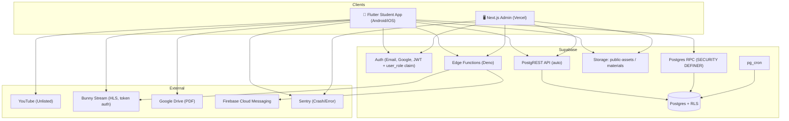
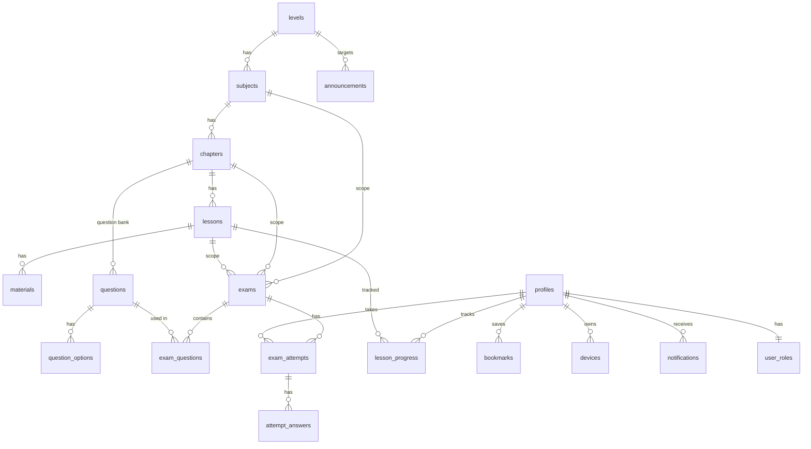
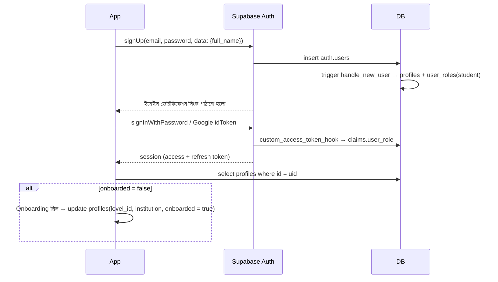
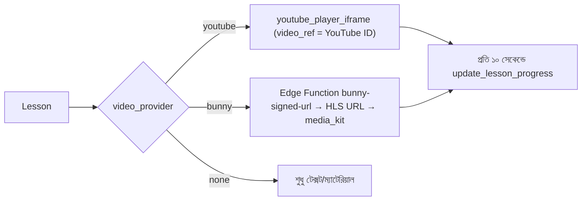

# 02 — Technical Requirements Document (TRD)

> এই ডকুমেন্টে পুরো সিস্টেমের টেকনিক্যাল আর্কিটেকচার আছে। কোন অংশের বিস্তারিত কোথায় পাবেন:
> ডাটাবেস → [03-DATABASE.md](03-DATABASE.md) · সিকিউরিটি → [04-SECURITY.md](04-SECURITY.md) · অ্যাপ → [06-FLUTTER-APP.md](06-FLUTTER-APP.md) · অ্যাডমিন → [07-ADMIN-PANEL.md](07-ADMIN-PANEL.md)

---

## ১. সিস্টেম আর্কিটেকচার



### ১.১ ডিজাইনের মূল নীতি
1. **Thin backend, smart database:** আলাদা কোনো API সার্ভার থাকবে না। সব ব্যবসায়িক নিয়ম চলবে Postgres-এর **RLS + RPC** দিয়ে, তাই সার্ভার maintain করার ঝামেলা নেই আর খরচও কম।
2. **Database is the security boundary:** অ্যাপ বা অ্যাডমিনের UI-তে কিছু লুকালেই সেটা সুরক্ষিত হয় না। প্রতিটা নিয়ম RLS-এ লেখা থাকবে।
3. **Server-authoritative exam:** এক্সামের প্রশ্ন বাছাই, shuffle, টাইমার আর গ্রেডিং সব হবে সার্ভারে।
4. **Edge Functions শুধু secret লাগলে:** যেমন Bunny token sign করা, FCM-এ push পাঠানো, অ্যাডমিন ইনভাইট, অ্যাকাউন্ট ডিলিট।
5. **No demo data:** migration-এ কোনো seed নেই। টেস্ট fixture আলাদা রাখা হবে।

---

## ২. টেক স্ট্যাক

| লেয়ার | টেকনোলজি | কেন |
|---|---|---|
| মোবাইল | Flutter 3.x (Dart 3), Riverpod, go_router, freezed | একটা কোডবেসে Android + iOS, পারফরম্যান্স ভালো, টাইপ-সেফ |
| অ্যাডমিন | Next.js 15 (App Router), React 19, TypeScript strict, Tailwind v4, shadcn/ui | SSR, Server Actions, দ্রুত সুন্দর UI |
| ব্যাকএন্ড | Supabase: Postgres 15+, PostgREST, Auth, Storage, Edge Functions, pg_cron | RLS-ভিত্তিক সিকিউরিটি, রিয়েলটাইম, কম খরচ |
| ভিডিও | YouTube Unlisted (ফ্রি) **অথবা** Bunny Stream (সিকিউর HLS) | অ্যাডমিন প্রতিটা ক্লাসের জন্য আলাদা বেছে নিতে পারবেন |
| PDF | Google Drive (অ্যাডমিনের পছন্দ) **অথবা** Supabase Storage (প্রাইভেট) | Drive সহজ, Storage বেশি নিরাপদ |
| Push | Firebase Cloud Messaging (HTTP v1) | ফ্রি, নির্ভরযোগ্য |
| মনিটরিং | Sentry (অ্যাপ + অ্যাডমিন), Supabase Logs | ক্র্যাশ আর এরর ট্র্যাকিং |
| হোস্টিং | Vercel (অ্যাডমিন), Supabase Cloud (Singapore রিজিয়ন, বাংলাদেশের সবচেয়ে কাছে) | কম latency |
| CI/CD | GitHub Actions | lint, test, build, deploy |

---

## ৩. রিপোজিটরি স্ট্রাকচার (Monorepo)

```
ClassRoom/
├── docs/                      ← এই ডকুমেন্টগুলো
├── supabase/
│   ├── config.toml
│   ├── migrations/
│   │   └── 20261103000000_init.sql      ← docs/sql/schema.sql কপি
│   ├── functions/
│   │   ├── _shared/ (cors.ts, auth.ts, supabase-admin.ts)
│   │   ├── bunny-signed-url/index.ts
│   │   ├── send-push/index.ts
│   │   ├── admin-invite/index.ts
│   │   └── delete-account/index.ts
│   └── tests/ (pgTAP RLS tests)
├── apps/
│   ├── mobile/                ← Flutter app
│   └── admin/                 ← Next.js admin
└── .github/workflows/ (mobile.yml, admin.yml, supabase.yml)
```

---

## ৪. ডেটা মডেল (সংক্ষেপে)



পুরো কলাম, কনস্ট্রেইন্ট, RLS আর RPC-এর বিবরণ আছে [03-DATABASE.md](03-DATABASE.md) আর [schema.sql](sql/schema.sql)-এ।

---

## ৫. API কন্ট্র্যাক্ট

আলাদা কোনো REST সার্ভার নেই। ক্লায়েন্ট তিনভাবে ব্যাকএন্ডের সাথে কথা বলবে:

### ৫.১ PostgREST (টেবিল query, RLS-সুরক্ষিত)

| ব্যবহার | Query (supabase-dart) |
|---|---|
| লেভেল লিস্ট (onboarding) | `from('levels').select('id,name,name_en,slug,icon_url').order('sort_order')` |
| সাবজেক্ট | `from('subjects').select('id,name,name_en,icon_url,color_hex').eq('level_id', lvl).order('sort_order')` |
| অধ্যায় + ক্লাস সংখ্যা | `from('chapters').select('id,chapter_no,title,description,lessons(count)').eq('subject_id', sid).order('sort_order')` |
| ক্লাস কার্ড | `from('lessons').select('id,title,thumbnail_url,video_duration_sec,is_premium,sort_order').eq('chapter_id', cid).order('sort_order')` |
| ক্লাস ডিটেইল | `from('lessons').select('*, materials(id,type,source,title,drive_file_id,storage_path,content_md,allow_download,page_count,sort_order)').eq('id', lid).single()` |
| ক্লাসের এক্সাম | `from('exams').select('id,title,mode,duration_sec,starts_at,ends_at,max_attempts,exam_questions(count)').eq('lesson_id', lid)` |
| অধ্যায়ের এক্সাম | `.eq('chapter_id', cid).eq('scope','chapter')` |
| নিজের প্রোগ্রেস | `from('lesson_progress').select('lesson_id,last_position_sec,is_completed').in_('lesson_id', ids)` |
| সার্চ | `from('lessons').select('id,title,thumbnail_url,chapters(title,subjects(name))').textSearch('search_vector', q, type: TextSearchType.websearch).limit(20)` |
| পাবলিক সেটিংস | `from('app_settings').select('key,value').eq('is_public', true)` |

> [!NOTE]
> `exam_questions(count)` কাজ করার জন্য স্টুডেন্টের ওই টেবিলে select পারমিশন লাগে, কিন্তু স্টুডেন্টের সেটা নেই (সিকিউরিটির কারণে)। তাই প্রশ্ন সংখ্যা দেখাতে `exams` টেবিলে একটা `question_count` কলাম রাখা যায়, যেটা trigger দিয়ে আপডেট হবে। এটা **Phase 1 টাস্ক** হিসেবে [08-ROADMAP.md](08-ROADMAP.md)-এ রাখা হয়েছে।

### ৫.২ RPC (বিজনেস লজিক)

| RPC | কে কল করবে | ইনপুট | আউটপুট |
|---|---|---|---|
| `start_exam` | স্টুডেন্ট | `p_exam_id` | attempt + প্রশ্ন (উত্তর ছাড়া) |
| `save_answer` | স্টুডেন্ট | `p_attempt_id, p_question_id, p_option_id` | void |
| `submit_exam` | স্টুডেন্ট | `p_attempt_id` | result jsonb |
| `get_attempt_result` | স্টুডেন্ট/অ্যাডমিন | `p_attempt_id` | result + review |
| `get_exam_leaderboard` | স্টুডেন্ট | `p_exam_id, p_limit` | rows |
| `update_lesson_progress` | স্টুডেন্ট | `p_lesson_id, p_position_sec, p_delta_watched_sec` | void |
| `get_my_dashboard` | স্টুডেন্ট | — | stats, continue watching, live exams |
| `get_my_subject_progress` | স্টুডেন্ট | `p_level_id` | rows |
| `get_my_weak_chapters` | স্টুডেন্ট | `p_limit` | rows |
| `admin_dashboard_stats` | অ্যাডমিন | — | jsonb |
| `admin_exam_stats` | অ্যাডমিন | `p_exam_id` | jsonb |

**এরর কোড:** RPC থেকে `raise exception '<CODE>'` আসে। ক্লায়েন্টে `PostgrestException.message` থেকে কোডটা নিয়ে বাংলা বার্তায় ম্যাপ করতে হবে:

| কোড | বাংলা বার্তা |
|---|---|
| `NOT_AUTHORIZED` | আপনার এই কাজের অনুমতি নেই |
| `EXAM_NOT_FOUND` | পরীক্ষাটি পাওয়া যায়নি |
| `PREMIUM_REQUIRED` | এই পরীক্ষাটি প্রিমিয়াম সদস্যদের জন্য |
| `EXAM_NOT_STARTED` | পরীক্ষা এখনো শুরু হয়নি |
| `EXAM_ENDED` | পরীক্ষার সময় শেষ হয়ে গেছে |
| `MAX_ATTEMPTS_REACHED` | আপনি সর্বোচ্চ সংখ্যকবার চেষ্টা করেছেন |
| `EXAM_HAS_NO_QUESTIONS` | এই পরীক্ষায় এখনো প্রশ্ন যোগ হয়নি |
| `ATTEMPT_CLOSED` / `TIME_UP` | সময় শেষ, আপনার উত্তর জমা হয়ে গেছে |
| `INVALID_QUESTION` / `INVALID_OPTION` | অবৈধ উত্তর, আবার চেষ্টা করুন |
| `ATTEMPT_NOT_FOUND` | পরীক্ষার তথ্য পাওয়া যায়নি |
| `ATTEMPT_IN_PROGRESS` | পরীক্ষা এখনো চলছে |

### ৫.৩ Edge Functions

| Function | Auth | কাজ |
|---|---|---|
| `bunny-signed-url` | স্টুডেন্ট JWT | `lesson_id` নিয়ে চেক করবে ক্লাসটা visible কিনা আর premium access আছে কিনা। তারপর Bunny-র token-authenticated HLS URL (মেয়াদ ৪ ঘণ্টা) রিটার্ন করবে। `BUNNY_TOKEN_KEY` থাকবে শুধু secret-এ। |
| `send-push` | অ্যাডমিন JWT (`is_admin` চেক) | টার্গেট (সবাই, লেভেল বা নির্দিষ্ট ইউজার) অনুযায়ী `devices.fcm_token` সংগ্রহ করে FCM HTTP v1-এ ৫০০ করে ব্যাচে পাঠাবে, `notifications` টেবিলে row insert করবে, আর অবৈধ token মুছে ফেলবে। |
| `admin-invite` | super_admin JWT | `auth.admin.inviteUserByEmail` কল করে `user_roles`-এ role সেট করবে। |
| `delete-account` | স্টুডেন্ট JWT | নিজের অ্যাকাউন্ট মুছবে `auth.admin.deleteUser`-এর মাধ্যমে (cascade হয়ে সব ডেটা মুছে যাবে)। এটা Play Store পলিসির জন্য বাধ্যতামূলক। |

**Edge Function টেমপ্লেট (Deno):**
```ts
// supabase/functions/bunny-signed-url/index.ts
import { createClient } from 'jsr:@supabase/supabase-js@2';
import { encodeHex } from 'jsr:@std/encoding/hex';

Deno.serve(async (req) => {
  if (req.method === 'OPTIONS') return new Response(null, { headers: cors });
  const authHeader = req.headers.get('Authorization');
  if (!authHeader) return json({ error: 'NOT_AUTHORIZED' }, 401);

  // ইউজারের JWT দিয়ে client → RLS প্রযোজ্য
  const supabase = createClient(Deno.env.get('SUPABASE_URL')!, Deno.env.get('SUPABASE_ANON_KEY')!, {
    global: { headers: { Authorization: authHeader } },
  });
  const { lesson_id } = await req.json();
  const { data: lesson, error } = await supabase
    .from('lessons').select('id, video_provider, video_ref, is_premium').eq('id', lesson_id).single();
  if (error || !lesson || lesson.video_provider !== 'bunny') return json({ error: 'NOT_FOUND' }, 404);
  if (lesson.is_premium) {
    const { data: ok } = await supabase.rpc('has_premium_access');
    if (!ok) return json({ error: 'PREMIUM_REQUIRED' }, 403);
  }

  const libraryHost = Deno.env.get('BUNNY_CDN_HOST')!;            // vz-xxxx.b-cdn.net
  const key = Deno.env.get('BUNNY_TOKEN_KEY')!;
  const expires = Math.floor(Date.now() / 1000) + 4 * 3600;
  const path = `/${lesson.video_ref}/`;
  const raw = new TextEncoder().encode(key + path + expires + 'token_path=' + path);
  const hash = btoa(String.fromCharCode(...new Uint8Array(await crypto.subtle.digest('SHA-256', raw))))
    .replace(/\+/g, '-').replace(/\//g, '_').replace(/=+$/, '');
  const url = `https://${libraryHost}/bcdn_token=${hash}&expires=${expires}&token_path=${encodeURIComponent(path)}${path}playlist.m3u8`;
  return json({ url, expires_at: expires });
});
```
> [!NOTE]
> Bunny-র token auth-এর সঠিক ফরম্যাট (directory token) Bunny ড্যাশবোর্ডের ডকুমেন্টেশনের সাথে একবার মিলিয়ে নেবেন। Library-তে "Token Authentication" চালু করতে হবে।

---

## ৬. মূল টেকনিক্যাল ফ্লো

### ৬.১ Auth ফ্লো


- অ্যাপ সেশন রাখবে `flutter_secure_storage`-এ (supabase_flutter-এর কাস্টম `LocalStorage` দিয়ে)।
- **Google Sign-In:** `google_sign_in` দিয়ে idToken নিয়ে `supabase.auth.signInWithIdToken(provider: OAuthProvider.google, idToken, accessToken)` কল করতে হবে। এর জন্য Supabase Dashboard-এ Web Client ID আর Android Client ID (SHA-1 সহ) সেট করতে হবে।
- **অ্যাডমিনে লগইন:** middleware JWT-র `user_role` claim চেক করবে, Server Action-এ `is_admin()` আবার চেক হবে, আর MFA (AAL2) বাধ্যতামূলক।

### ৬.২ ভিডিও প্লেব্যাক

- **YouTube:** ভিডিও অবশ্যই *Unlisted* হতে হবে (Private হলে embed চলে না)। অ্যাপে `showControls` থাকবে, কিন্তু related ভিডিও আর YouTube লোগো লিংক যতটা সম্ভব লুকানো থাকবে (`strictRelatedVideos`)। মনে রাখবেন, YouTube-এর লিংক লিক হতে পারে।
- **Bunny:** token-signed URL, মেয়াদ শেষ হলে নতুন URL নিতে হবে। অ্যাডমিন চাইলে Bunny-তে MediaCage DRM চালু করতে পারেন।

### ৬.৩ Google Drive PDF
| কাজ | URL |
|---|---|
| অ্যাডমিন যা পেস্ট করবে | `https://drive.google.com/file/d/{FILE_ID}/view?usp=sharing` |
| ID বের করার regex | `/(?:\/d\/|[?&]id=)([A-Za-z0-9_-]{10,})/` |
| অ্যাপে প্রিভিউ (WebView) | `https://drive.google.com/file/d/{FILE_ID}/preview` |
| ডাউনলোড (ফাইল বড় হলেও কাজ করে) | `https://drive.usercontent.google.com/download?id={FILE_ID}&export=download&confirm=t` |

- **প্রিভিউর জন্য প্রস্তাবিত পদ্ধতি:** ডাউনলোড URL থেকে ফাইলটা অ্যাপের cache-এ নামিয়ে `pdfrx` দিয়ে নেটিভভাবে রেন্ডার করা। এতে দ্রুত চলে, জুম আর সার্চ কাজ করে, আর স্ক্রিনশট ব্লক করা যায়। এটা ব্যর্থ হলে fallback হিসেবে WebView-এ `/preview` খুলবে।
- Response-এর `Content-Type` যদি `text/html` আসে, তাহলে বুঝতে হবে ফাইলটা পাবলিক না, তখন এরর দেখাবে।
- ডাউনলোড করা ফাইল থাকবে `getApplicationDocumentsDirectory()/downloads/{material_id}.pdf`-এ। ইনডেক্স রাখা হবে লোকাল DB-তে (Drift/Hive)।

> [!WARNING]
> Drive-এ "Anyone with link" দেওয়া ফাইল লিংক জানা যে কেউ খুলতে পারে। গোপন বা পেইড কনটেন্টের জন্য `source = 'storage'` (প্রাইভেট bucket, ১ ঘণ্টার signed URL) ব্যবহার করুন।

### ৬.৪ এক্সাম ইঞ্জিন: টাইমার আর অফলাইন সহনশীলতা
- `start_exam` রেসপন্সে `server_now` আসে। ক্লায়েন্টে `offset = server_now - DateTime.now()` হিসাব করতে হবে। বাকি সময় = `deadline_at - (DateTime.now() + offset)`।
- টাইমার UI প্রতি সেকেন্ডে আপডেট হবে, কিন্তু সময়ের মূল হিসাব সবসময় deadline থেকে।
- `save_answer` ব্যর্থ হলে উত্তর লোকাল queue-তে (Hive) থাকবে আর exponential backoff দিয়ে retry হবে। সাবমিটের আগে queue খালি (flush) করতে হবে।
- সার্ভারে ১০ সেকেন্ডের network grace আছে। এর পরে আসা উত্তর `TIME_UP` এরর পাবে।
- অ্যাপ ব্যাকগ্রাউন্ডে গেলে টাইমার চলতেই থাকবে (হিসাব deadline-ভিত্তিক)। চাইলে লোকাল নোটিফিকেশন দেওয়া যায়: *"পরীক্ষা চলছে, ২ মিনিট বাকি"*।

### ৬.৫ ক্যাশিং ও অফলাইন
| ডেটা | কৌশল |
|---|---|
| Levels/Subjects/Chapters/Lessons লিস্ট | Stale-while-revalidate: আগে লোকাল ক্যাশ (Drift) দেখাবে, তারপর নেটওয়ার্ক থেকে আপডেট করবে |
| ছবি | `cached_network_image` (ডিস্ক ক্যাশ ৭ দিন) |
| PDF | ডাউনলোড করলে স্থায়ীভাবে থাকবে; প্রিভিউর জন্য temp ক্যাশ |
| Exam | **সবসময় অনলাইন লাগবে** (শুরু আর সাবমিট), মাঝখানে নেট গেলে queue |
| Dashboard | মেমরি ক্যাশ ৫ মিনিট, pull-to-refresh |

### ৬.৬ Push নোটিফিকেশন
1. অ্যাপ লঞ্চে FCM token নিয়ে `devices` টেবিলে upsert করবে (`user_id, device_id`)। token রিফ্রেশ হলে আবার upsert।
2. অ্যাডমিন প্যানেল থেকে `send-push` Edge Function কল করলে সেটা FCM-এ পাঠাবে আর `notifications` টেবিলে row insert করবে।
3. নোটিফিকেশনের ডেটায় `deep_link` থাকবে (যেমন `classroom://lesson/<id>`)। ট্যাপ করলে go_router সংশ্লিষ্ট স্ক্রিনে নিয়ে যাবে।

### ৬.৭ ফোর্স আপডেট ও মেইনটেন্যান্স
`app_settings`-এ যে public key-গুলো থাকবে:
```json
{ "min_app_version": "1.0.0", "latest_app_version": "1.0.3",
  "maintenance_mode": false, "maintenance_message": "সার্ভার আপডেট চলছে, কিছুক্ষণ পর আসুন",
  "support_contact": "..." }
```
Splash স্ক্রিনে `package_info_plus`-এর ভার্সন যদি `min_app_version`-এর চেয়ে কম হয়, তাহলে ব্লকিং আপডেট স্ক্রিন দেখাবে। `maintenance_mode = true` হলে মেইনটেন্যান্স স্ক্রিন দেখাবে।
> এই key-গুলো অ্যাডমিন প্যানেলের Settings পেজ থেকে প্রথমবার সেভ করার সময় তৈরি হবে। কোনো seed নেই। অ্যাপে key না পেলে নিরাপদ ডিফল্ট ধরবে (কোনো ব্লক না)।

---

## ৭. পারফরম্যান্স ও স্কেলিং
- **Indexes:** সব FK আর sort কলামে index আছে ([schema.sql](sql/schema.sql) §9)। লিডারবোর্ডের জন্য partial index `idx_attempts_exam_score` আছে।
- **Pagination:** সব লিস্টে `.range(from, to)` দিয়ে ২০টা করে আসবে। অ্যাডমিন টেবিলে `count: 'estimated'` ব্যবহার হবে।
- **Payload:** দরকারি কলামগুলোই শুধু `select` করতে হবে, `*` এড়াতে হবে (ডিটেইল স্ক্রিন বাদে)।
- **লাইভ এক্সামের বাড়তি চাপ:** ৫,০০০ জন একসাথে `start_exam` করলে চাপ সামলাতে Supabase compute কমপক্ষে Small/Medium রাখতে হবে আর connection pooler (Supavisor, transaction mode) চালু থাকবে। ক্লায়েন্টে "শুরু করুন" বাটনে 0–3 সেকেন্ডের random jitter থাকবে।
- **RLS পারফরম্যান্স:** helper function-গুলো `stable` আর `security definer`, policy-তে `auth.uid()` ব্যবহার হয়েছে। লোড বেশি হলে `(select auth.uid())` প্যাটার্নে বদলানো যায়।
- **Leaderboard:** খুব বড় এক্সামে materialized view বা cache টেবিল ব্যবহার করে প্রতি মিনিটে refresh করা যায় (v1.1)।

---

## ৮. এনভায়রনমেন্ট ও কনফিগারেশন

| এনভায়রনমেন্ট | Supabase প্রজেক্ট | অ্যাপ flavor | অ্যাডমিন |
|---|---|---|---|
| Local | `supabase start` (Docker) | `dev` | `localhost:3000` |
| Staging | `classroom-staging` | `staging` | Vercel Preview |
| Production | `classroom-prod` | `prod` | `admin.yourdomain.com` |

**Secrets কোথায় থাকবে:**
| Secret | কোথায় | কখনো যাবে না |
|---|---|---|
| `SUPABASE_URL`, `SUPABASE_ANON_KEY` (publishable) | অ্যাপ (`--dart-define-from-file`), অ্যাডমিন `NEXT_PUBLIC_*` | — (এগুলো পাবলিক হওয়াই স্বাভাবিক, RLS দিয়ে সুরক্ষিত) |
| `SUPABASE_SERVICE_ROLE_KEY` | শুধু অ্যাডমিন সার্ভার (`server-only`) আর Edge Functions | ❌ অ্যাপ, ❌ ব্রাউজার, ❌ git |
| `BUNNY_TOKEN_KEY`, `BUNNY_API_KEY` | Edge Function secrets | ❌ অ্যাপ |
| `FCM_SERVICE_ACCOUNT_JSON` | Edge Function secrets | ❌ অ্যাপ |
| `google-services.json` | অ্যাপ (এটা secret না, তবে public repo-তে রাখবেন না) | — |

---

## ৯. লগিং, মনিটরিং, অ্যানালিটিক্স
- **Sentry:** অ্যাপে `sentry_flutter` আর অ্যাডমিনে `@sentry/nextjs`। PII scrub করা থাকবে (ইমেইল বা ফোন পাঠানো হবে না)।
- **Supabase:** API, Postgres আর Edge Function লগ দেখা। Slow query alert রাখতে হবে।
- **প্রোডাক্ট অ্যানালিটিক্স:** প্রধান মেট্রিক আসবে নিজস্ব DB থেকে (`lesson_progress`, `exam_attempts`)। চাইলে Firebase Analytics যোগ করা যায় (screen_view, lesson_play, exam_submit ইভেন্ট)।
- **Audit:** কনটেন্ট টেবিলের প্রতিটা পরিবর্তন trigger দিয়ে `audit_logs`-এ যাবে।

---

## ১০. ব্যাকআপ ও ডিজাস্টার রিকভারি
- Supabase Pro-তে দৈনিক ব্যাকআপ আর PITR (৭ দিন) চালু রাখতে হবে।
- Storage bucket সপ্তাহে একবার অন্য জায়গায় (যেমন Backblaze/R2) sync করা যায় (`rclone` + GitHub Action)।
- Migration সবসময় git-এ থাকবে। Production-এ শুধু `supabase db push` দিয়ে পরিবর্তন হবে, Dashboard থেকে সরাসরি schema বদলানো নিষেধ।

---

## ১১. টেস্টিং কৌশল

| লেয়ার | টুল | কী টেস্ট হবে |
|---|---|---|
| DB / RLS | pgTAP (`supabase test db`) | স্টুডেন্ট উত্তর পড়তে পারে না, নিজের role বাড়াতে পারে না, unpublished কনটেন্ট লুকানো, গ্রেডিং ঠিক, নেগেটিভ মার্কিং |
| Flutter unit | `flutter_test` + `mocktail` | repository, timer offset, error mapping, Drive URL parser |
| Flutter widget/golden | `flutter_test`, `alchemist` | Empty/Loading/Error স্টেট, কার্ড, dark mode |
| Flutter integration | `patrol` / `integration_test` | লগইন → ক্লাস → এক্সাম পুরো ফ্লো (লোকাল Supabase-এ) |
| অ্যাডমিন unit | Vitest | Zod validator, YouTube/Drive parser, CSV import |
| অ্যাডমিন E2E | Playwright | লগইন, সাবজেক্ট → ক্লাস তৈরি, এক্সাম উইজার্ড |
| লোড টেস্ট | k6 | লাইভ এক্সামে ৫,০০০ জন একসাথে `start_exam` আর `save_answer` |

> [!IMPORTANT]
> টেস্টে যে ইউজার বা কনটেন্ট লাগবে, সেটা টেস্টের setup ধাপে তৈরি হবে আর teardown-এ মুছে যাবে। এগুলো থাকবে শুধু লোকাল বা স্টেজিং DB-তে। **Production migration-এ কখনো seed থাকবে না।**

> ✅ বর্তমান স্কিমা PGlite (পুরো Postgres engine)-এ ২৭টা ইন্টিগ্রেশন টেস্ট দিয়ে যাচাই করা হয়েছে: RLS, এক্সাম ইঞ্জিন, গ্রেডিং, লিডারবোর্ড, প্রোগ্রেস, অটো-এক্সপায়ার, ব্লক করা ইউজার।

