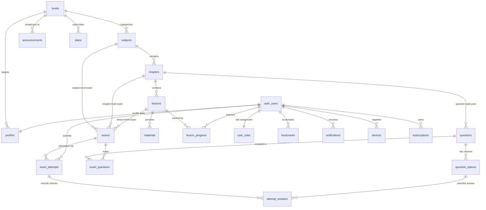

# 03 — Database Schema & Architecture Guide

> এই ডকুমেন্টে ClassRoom প্ল্যাটফর্মের সম্পূর্ণ ডাটাবেস ডিজাইন, রিলেশনশিপ, কনস্ট্রেইন্ট, আরপিসি (RPC) ফাংশন এবং সিকিউরিটি পলিসির বিস্তারিত বর্ণনা রয়েছে।
> কার্যকর SQL কোডটি সরাসরি [`docs/sql/schema.sql`](sql/schema.sql) ফাইলে পাবেন।

---

## ১. ডাটাবেস ওভারভিউ ও ডিজাইন দর্শন

ClassRoom প্ল্যাটফর্মে **PostgreSQL (Supabase)**-কে কেবল সাধারণ ডেটা স্টোর হিসেবে নয়, বরং **অ্যাপ্লিকেশনের মূল ব্যবসায়িক নিয়ম ও সিকিউরিটি বাউন্ডারি** হিসেবে ডিজাইন করা হয়েছে।

### মূল বৈশিষ্ট্যসমূহ:
1. **Zero Fake/Demo Data Policy:** ডাটাবেসে কোনো ডামি কনটেন্ট বা হার্ডকোডেড ডেটা ইনসার্ট করা নেই। সব কনটেন্ট অ্যাডমিন প্যানেল থেকে ইনপুট হবে।
2. **Database-Driven Security:** অ্যাপ্লিকেশন লেয়ারের উপরে নির্ভর না করে PostgreSQL-এর নেটিভ **Row Level Security (RLS)** ব্যবহার করা হয়েছে। স্টুডেন্ট ক্লায়েন্ট সরাসরি ডাটাবেসে ক্যোয়ারী করলেও RLS রুল লঙ্ঘন করতে পারবে না।
3. **Server-Authoritative Exam Engine:** পরীক্ষার সঠিক উত্তর কখনোই স্টুডেন্ট অ্যাপে পাঠানো হয় না। `SECURITY DEFINER` আরপিসির মাধ্যমে সার্ভার সাইডে প্রশ্ন শাফল, টাইমার যাচাই এবং খাতা মূল্যায়ন করা হয়।
4. **Automated Audit Logging:** কনটেন্ট ও ইউজার রোলে কোনো পরিবর্তন এলে স্বয়ংক্রিয় ট্রিগারের মাধ্যমে `audit_logs` টেবিলে আগের এবং পরের ডেটা সংরক্ষণ করা হয়।

---

## ২. Entity-Relationship (ER) ডায়াগ্রাম



---

## ৩. টেবিল ডিকশনারি (Data Dictionary)

### ৩.১ ইউজার ও অথেনটিকেশন লেয়ার

#### `public.levels`
শিক্ষাগত স্তর বা শ্রেণি (যেমন: HSC, SSC)।
| কলাম | টাইপ | কনস্ট্রেইন্ট | বিবরণ |
|---|---|---|---|
| `id` | uuid | PK, default gen_random_uuid() | স্তরের অনন্য শনাক্তকারী |
| `name` | text | NOT NULL, 1..80 chars | বাংলা নাম (e.g., 'এইচএসসি') |
| `name_en` | text | Nullable | ইংরেজি নাম (e.g., 'HSC') |
| `slug` | text | UNIQUE, regex `^[a-z0-9-]+$` | URL ফ্রেন্ডলি স্লাগ (e.g., 'hsc') |
| `description` | text | Nullable | স্তরের বিবরণ |
| `icon_url` | text | Nullable | আইকন ছবির URL |
| `sort_order` | int | NOT NULL, default 0 | প্রদর্শনের ক্রম |
| `is_published`| boolean | NOT NULL, default false | প্রকাশনার স্থিতি |
| `created_at` / `updated_at` | timestamptz | NOT NULL, default now() | টাইমস্ট্যাম্প |

#### `public.profiles`
স্টুডেন্ট ও অ্যাডমিনদের অতিরিক্ত তথ্য (`auth.users`-এর সাথে 1:1)।
| কলাম | টাইপ | কনস্ট্রেইন্ট | বিবরণ |
|---|---|---|---|
| `id` | uuid | PK, FK auth.users(id) ON DELETE CASCADE | ইউজারের ID |
| `full_name` | text | <= 100 chars | পুরো নাম |
| `avatar_url` | text | Nullable | প্রোফাইল ছবির লিংক |
| `phone` | text | Nullable, regex validation | ফোন নম্বর |
| `institution` | text | <= 150 chars | কলেজ বা স্কুলের নাম |
| `level_id` | uuid | FK levels(id) ON DELETE SET NULL | স্টুডেন্টের নির্বাচিত স্তর |
| `locale` | text | 'bn' বা 'en', default 'bn' | ভাষা পছন্দ |
| `is_blocked` | boolean | NOT NULL, default false | স্টুডেন্ট নিষিদ্ধ কিনা |
| `onboarded` | boolean | NOT NULL, default false | অনবোর্ডিং সম্পন্ন কিনা |
| `last_seen_at` | timestamptz | Nullable | শেষ সক্রিয়তার সময় |

#### `public.user_roles`
ইউজারের পারমিশন ও রোল ম্যানেজমেন্ট।
| কলাম | টাইপ | কনস্ট্রেইন্ট | বিবরণ |
|---|---|---|---|
| `user_id` | uuid | PK, FK auth.users(id) ON DELETE CASCADE | ইউজারের ID |
| `role` | app_role | NOT NULL, default 'student' | 'student', 'admin', 'super_admin' |
| `granted_by`| uuid | FK auth.users(id) | কে রোল প্রদান করেছে |
| `created_at`| timestamptz | NOT NULL, default now() | টাইমস্ট্যাম্প |

---

### ৩.২ কনটেন্ট হায়ারার্কি লেয়ার

#### `public.subjects`
পাঠ্য বিষয় (যেমন: পদার্থবিজ্ঞান, রসায়ন)।
- `level_id` (FK levels) এর সাথে সংযুক্ত।
- `color_hex` (HEX কোড যেমন: `#3B82F6`) স্টুডেন্ট অ্যাপে সাবজেক্ট কার্ডের ব্যাকগ্রাউন্ড ও থিম রঙ হিসেবে ব্যবহৃত হয়।
- `unique (level_id, slug)` এনশিওর করে একই লেভেলে একই স্লাগ একাধিকবার হবে না।

#### `public.chapters`
বিষয়ের অন্তর্ভুক্ত অধ্যায় (যেমন: অধ্যায় ১: ভৌত জগত ও পরিমাপ)।
- `subject_id` (FK subjects) এর সাথে সংযুক্ত।
- `chapter_no`: ক্রমিক সংখ্যা (যেমন: 1, 2, 3)।

#### `public.lessons`
অধ্যায়ের আওতাধীন ক্লাস বা পাঠ।
- `video_provider`: `youtube`, `bunny`, অথবা `none`।
- `video_ref`: YouTube ভিডিও ID (যেমন `dQw4w9WgXcQ`) অথবা Bunny ভিডিও GUID।
- `video_duration_sec`: ভিডিওর মোট দৈর্ঘ্য (সেকেন্ডে)।
- `search_vector`: `tsvector` কলাম যা স্বয়ংক্রিয়ভাবে `title` ও `description` ইনডেক্স করে ফুল-টেক্সট সার্চ সহজ করে।
- `is_premium`: পেইড ব্যাচের জন্য সংরক্ষিত রাখার ফ্ল্যাগ (MVP-তে ডিফল্ট false)।

#### `public.materials`
ক্লাস সংক্রান্ত সহায়ক উপাদান (লেকচার শিট, ক্লাস নোট ইত্যাদি)।
- `type`: `lecture_sheet`, `class_note`, বা `other`।
- `source`:
  - `drive`: Google Drive ফাইল ID (`drive_file_id`)। অ্যাপে সরাসরি প্রিভিউ ও ডাউনলোডের ব্যবস্থা।
  - `storage`: Supabase প্রাইভেট বাকেটের ফাইল পাথ (`storage_path`)।
  - `rich_text`: সরাসরি Markdown ও LaTeX সম্বলিত টেক্সট নোট (`content_md`)।
- `allow_download`: অ্যাডমিন ডাউনলোড অপশন বন্ধ রাখতে চান কিনা।

---

### ৩.৩ এক্সাম ও কোশ্চেন ব্যাংক লেয়ার

#### `public.questions`
অধ্যায়ভিত্তিক সার্বজনীন প্রশ্নব্যাংক।
- `body`: Markdown ও LaTeX সম্বলিত মূল প্রশ্ন।
- `image_url`: প্রশ্নের ছবি (যদি থাকে)।
- `explanation`: প্রশ্নের বিস্তারিত সমাধান বা ব্যাখ্যা।
- `difficulty`: `easy`, `medium`, `hard`।
- `tags`: ট্যাগ অ্যারে (যেমন: `['HSC-24', 'ঢাকা-বোর্ড']`)।

#### `public.question_options`
প্রশ্নের সম্ভাব্য উত্তর বা অপশন।
- `body` এবং ঐচ্ছিক `image_url`।
- `is_correct`: অপশনটি সঠিক কিনা।
- **Partial Unique Index:** `uq_one_correct_option` নিশ্চিত করে প্রতি প্রশ্নে শুধুমাত্র একটি সঠিক উত্তর থাকবে।

#### `public.exams`
পরীক্ষার মেটাডেটা ও সেটিংস।
- `scope`: `lesson`, `chapter`, অথবা `subject`।
- `mode`: `practice` (যেকোনো সময় দেওয়া যায়) অথবা `live` (নির্দিষ্ট সময়ের উইন্ডো)।
- `starts_at` ও `ends_at`: লাইভ পরীক্ষার সময়সীমা।
- `duration_sec`: পরীক্ষার মোট সময়কাল (সেকেন্ডে)।
- `mark_per_question`: প্রতিটি সঠিক উত্তরের মান।
- `negative_mark`: ভুল উত্তরের জন্য কর্তনকৃত নম্বর (default 0)।
- `shuffle_questions` ও `shuffle_options`: প্রশ্ন ও অপশন এলোমেলো করা হবে কিনা।
- `answer_visibility`: `immediately` (পরীক্ষা শেষেই), `after_end` (লাইভ পরীক্ষা শেষ হওয়ার পর), অথবা `never` (কখনোই না)।

#### `public.exam_questions`
কোন পরীক্ষায় কোন কোন প্রশ্ন থাকবে তার ম্যাপিং টেবিল (Join Table)।

#### `public.exam_attempts`
স্টুডেন্টের পরীক্ষার অংশগ্রহণের রেকর্ড।
- `status`: `in_progress`, `submitted`, অথবা `expired`।
- `deadline_at`: সার্ভার কর্তৃক নির্ধারিত সমাপ্তির শেষ সময় (`started_at + duration_sec`)।
- `question_order`: শাফলকৃত প্রশ্ন আইডির অ্যারে (`uuid[]`)।
- `option_order`: শাফলকৃত অপশন আইডির ম্যাপিং (`jsonb`)।
- `score`, `percentage`, `is_passed`, `time_taken_sec`: পরীক্ষার ফলাফল।

#### `public.attempt_answers`
পরীক্ষায় স্টুডেন্টের দেওয়া প্রতিটি উত্তরের ট্র্যাক।
- `selected_option_id`: স্টুডেন্টের নির্বাচিত অপশন।
- `is_correct`: সার্ভার সাইডে ফাইনাল করার সময় সেট হয় (সাবমিটের পূর্বে স্টুডেন্ট এটি দেখতে পায় না)।

---

### ৩.৪ ট্র্যাকিং ও এনগেজমেন্ট লেয়ার

- **`lesson_progress`**: স্টুডেন্ট কতটুকু ভিডিও দেখেছে (`last_position_sec`, `watched_sec`), ৯০% এর বেশি দেখলে স্বয়ংক্রিয়ভাবে `is_completed = true` হয়।
- **`bookmarks`**: ক্লাস, ম্যাটেরিয়াল বা প্রশ্ন বুকমার্ক করে রাখার টেবিল।
- **`announcements`**: নোটিশ বা ঘোষণা (নির্দিষ্ট লেভেলের জন্য বা সবার জন্য)।
- **`notifications`**: ব্যক্তিগত পুশ নোটিফিকেশনের হিস্টোরি।
- **`devices`**: ইউজারের ডিভাইস আইডি এবং FCM পুশ টোকেন।
- **`audit_logs`**: অ্যাডমিনদের সমস্ত ডেটা পরিবর্তনের অপরিবর্তনীয় হিস্টোরি (JSON Diff সহ)।
- **`app_settings`**: সিস্টেম কনফিগারেশন যেমন `min_app_version`, `maintenance_mode` ইত্যাদি।

---

## ৪. সিকিউরিটি ও RLS পলিসি ম্যাট্রিক্স

সব টেবিলে `ROW LEVEL SECURITY` এনাবল করা আছে। প্রধান পলিসিসমূহ:

| টেবিল | Student (Authenticated) অ্যাক্সেস | Admin / Super Admin অ্যাক্সেস |
|---|---|---|
| `levels`, `subjects`, `chapters`, `lessons` | শুধুমাত্র `is_published = true` এবং প্যারেন্ট পাবলিশড থাকলে SELECT | সম্পূর্ণ CRUD অ্যাক্সেস |
| `materials` | পাবলিশড এবং লেসন ফ্রি হলে (অথবা সাবস্ক্রিপশন থাকলে) SELECT | সম্পূর্ণ CRUD অ্যাক্সেস |
| `questions`, `question_options`, `exam_questions` | **সরাসরি কোনো SELECT পারমিশন নেই** (শুধু RPC দিয়ে পাওয়া যাবে) | সম্পূর্ণ CRUD অ্যাক্সেস |
| `exams` | শুধুমাত্র `is_published = true` থাকলে SELECT | সম্পূর্ণ CRUD অ্যাক্সেস |
| `exam_attempts` | শুধুমাত্র নিজের attempt SELECT (ইনসার্ট/আপডেট শুধু RPC দ্বারা) | সব attempt SELECT ও অ্যানালিটিক্স |
| `attempt_answers` | শুধুমাত্র নিজের attempt-এর উত্তর SELECT | সম্পূর্ণ অ্যাক্সেস |
| `profiles` | নিজের প্রোফাইল SELECT ও নির্দিষ্ট ফিল্ড UPDATE | সব প্রোফাইল দেখা ও ব্লক/আনব্লক |
| `user_roles` | নিজের রোল শুধুমাত্র SELECT | `super_admin` ছাড়া কেউ রোল বদলাতে পারে না |
| `audit_logs` | কোনো অ্যাক্সেস নেই | শুধু SELECT অ্যাক্সেস |

---

## ৫. মূল আরপিসি (RPC) ফাংশনসমূহের বিবরণ

### ৫.১ `public.start_exam(p_exam_id uuid) -> jsonb`
- **কাজ:** পরীক্ষা শুরু করে বা মাঝপথে অ্যাপ বন্ধ হয়ে থাকলে চলমান পরীক্ষাটি রেজুউম (Resume) করে।
- **সিকিউরিটি:**
  - স্টুডেন্ট ব্লকড কিনা যাচাই করে।
  - লাইভ পরীক্ষার ক্ষেত্রে সময় উইন্ডো চেক করে।
  - সর্বোচ্চ চেষ্টা সীমা (`max_attempts`) চেক করে।
- **রিটার্ন ভ্যালু:** প্রশ্ন ও অপশনের তালিকা প্রদান করে। **কোনো সঠিক উত্তরের তথ্য ক্লায়েন্টে পাঠানো হয় না।**

### ৫.২ `public.save_answer(p_attempt_id uuid, p_question_id uuid, p_option_id uuid)`
- **কাজ:** স্টুডেন্ট অপশন সিলেক্ট করার সাথে সাথে সার্ভারে অটো-সেভ করে।
- **সিকিউরিটি:**
  - টাইম আউটের পর কোনো রিকোয়েস্ট গ্রহণ করে না (১০ সেকেন্ডের নেটওয়ার্ক গ্রেস বাদে)।
  - অপশনটি ওই নির্দিষ্ট প্রশ্নের কিনা তা যাচাই করে।

### ৫.৩ `public.submit_exam(p_attempt_id uuid) -> jsonb`
- **কাজ:** পরীক্ষা ফাইনাল সাবমিট করে এবং গ্রেডিং সম্পন্ন করে।
- **গ্রেডিং লজিক:**
  $$\text{Score} = \max(0, (\text{Correct} \times \text{MarkPerQuestion}) - (\text{Wrong} \times \text{NegativeMark}))$$
- **রিটার্ন:** প্রাপ্ত নম্বর, শতকরা হার, পাস/ফেল, এবং `answer_visibility` পলিসি অনুযায়ী প্রশ্নগুলোর সমাধান ও ব্যাখ্যা।

### ৫.৪ `public.get_exam_leaderboard(p_exam_id uuid, p_limit int) -> table`
- **কাজ:** শুধুমাত্র প্রথম অ্যাটেম্পটের ভিত্তিতে সর্বোচ্চ নম্বর ও কম সময়ের ক্রমানুসারে র‍্যাংক হিসাব করে লিডারবোর্ড প্রদান করে।

### ৫.৫ `public.update_lesson_progress(p_lesson_id uuid, p_position_sec int, p_delta_watched_sec int)`
- **কাজ:** ভিডিও কতটুকু দেখা হয়েছে তা আপডেট করে।
- **অ্যান্টি-চিট মেকানিজম:** প্রতি পিং-এ সর্বোচ্চ ৬০ সেকেন্ড পর্যন্ত ওয়াচ-টাইম গ্রহণ করা হয়, যাতে স্ক্রিপ্ট চালিয়ে সেকেন্ডেই সম্পন্ন করা অসম্ভব হয়।

---

## ৬. স্টোরেজ বাকেট স্ট্রাকচার

1. **`public-assets` (Public Read):**
   - আকার সীমা: 5 MB
   - ফাইল টাইপ: `image/png`, `image/jpeg`, `image/webp`, `image/svg+xml`
   - পাথ প্যাটার্ন:
     - `subjects/<uuid>.webp`
     - `thumbnails/<uuid>.webp`
     - `questions/<uuid>.webp`
     - `avatars/<user_id>/profile.webp` (স্টুডেন্ট শুধু তার নিজস্ব ফোল্ডারে আপলোড করতে পারে)

2. **`materials` (Private Read - RLS Protected):**
   - আকার সীমা: 100 MB
   - ফাইল টাইপ: `application/pdf`
   - স্টুডেন্ট সরাসরি বাকেটের ফাইলে অ্যাক্সেস পায় না; লেসন পাবলিশড ও অ্যাক্সেসযোগ্য হলে তবেই রিড পারমিশন মেলে।

---

## ৭. স্কিমা প্রয়োগের ধাপ (Execution Steps)

1. **লোকাল ডেভেলপমেন্টে (Supabase CLI):**
   ```bash
   cd ClassRoom/supabase
   supabase db reset
   # অথবা
   supabase migration new init
   cp ../docs/sql/schema.sql migrations/<timestamp>_init.sql
   supabase db push
   ```

2. **প্রোডাকশন / Supabase ক্লাউডে:**
   - Supabase Dashboard-এ যান।
   - বামপাশের মেনু থেকে **SQL Editor** ওপেন করুন।
   - [`docs/sql/schema.sql`](sql/schema.sql) ফাইলের সম্পূর্ণ টেক্সট পেস্ট করে **Run** চাপুন।
   - এরপর **Authentication** -> **Hooks**-এ গিয়ে **Custom Access Token (JWT)** হুক হিসেবে `public.custom_access_token_hook` নির্বাচন করে সংরক্ষণ করুন।

3. **প্রথম অ্যাডমিন সেটআপ (One-Time Manual Step):**
   - অ্যাডমিন প্যানেল বা Supabase Auth থেকে সাধারণ সাইনআপ করুন।
   - SQL Editor-এ নিচের ক্যোয়ারীটি চালান:
     ```sql
     update public.user_roles set role = 'super_admin'
     where user_id = (select id from auth.users where email = 'admin@yourdomain.com');
     ```
   - সাইনআউট করে পুনরায় লগইন করুন। JWT-তে সুপার অ্যাডমিন প্রিভিলেজ যুক্ত হবে।

