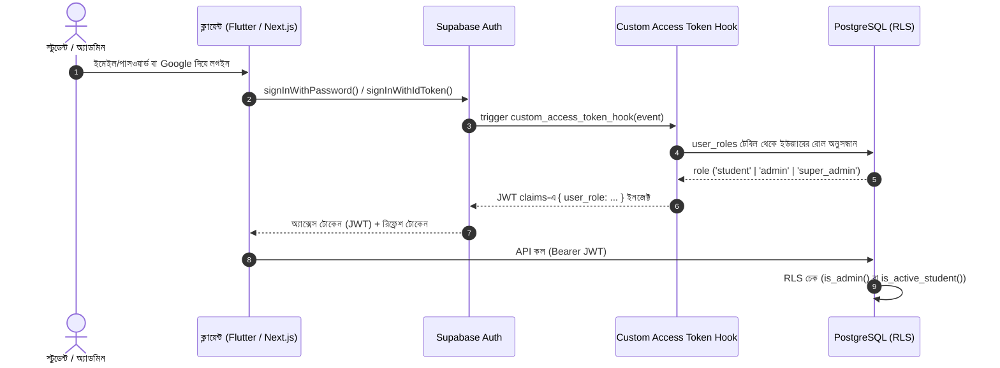

# 04 — Security & Anti-Cheat Specification

> এই ডকুমেন্টে ClassRoom প্ল্যাটফর্মের অথেনটিকেশন, রোল-বেসড অ্যাক্সেস কন্ট্রোল (RBAC), Row-Level Security (RLS), পরীক্ষার অ্যান্টি-চিট মেকানিজম এবং মিডিয়া সিকিউরিটির সম্পূর্ণ টেকনিক্যাল স্পেসিফিকেশন প্রদান করা হয়েছে।

---

## ১. থ্রেট মডেল ও সিকিউরিটি দর্শন

একটি শিক্ষামূলক প্ল্যাটফর্মে সবচেয়ে সংবেদনশীল বিষয় হলো:
1. **পরীক্ষার প্রশ্ন ও সঠিক উত্তর ফাঁস রোধ করা।**
2. **ক্লায়েন্ট সাইডের সময় কারচুপি করে পরীক্ষায় অসদুপায় অবলম্বন ঠেকানো।**
3. **পেইড বা এক্সক্লুসিভ কনটেন্ট (ভিডিও, শিট) পাইরেসি বা অবৈধ ডাউনলোড থেকে রক্ষা করা।**
4. **অ্যাডমিন অ্যাক্সেস সুরক্ষিত রাখা এবং ইউজারদের প্রিভিলেজ এসকেলেশন (অননুমোদিত পদোন্নতি) ঠেকানো।**

আমাদের মূল নীতি: **"Never trust the client. The database and backend are the single source of truth."**

---

## ২. অথেনটিকেশন ও টোকেন ম্যানেজমেন্ট



### ২.১ টোকেন সিকিউরিটি ও স্টোরেজ
- **Flutter Student App:**
  - সেশন ও টোকেন ডিভাইস কিচেইন/কিস্টোরে সংরক্ষিত হবে (`flutter_secure_storage` ব্যবহার করে)।
  - কোনো সাধারণ SharedPreferences বা ফাইল সিস্টেমে প্লেইনটেক্সট টোকেন থাকবে না।
- **Next.js Admin Panel:**
  - `@supabase/ssr` ব্যবহার করে সেশন শুধুমাত্র `HttpOnly`, `Secure`, `SameSite=Lax` কুকিতে সংরক্ষিত থাকবে।
  - জাভাস্ক্রিপ্ট (XSS) দ্বারা কুকি চুরি করা অসম্ভব।
- **Custom Access Token Hook:**
  - Supabase Auth-এর মাধ্যমে প্রতিবার JWT ইস্যু করার সময় `public.custom_access_token_hook` এক্সিকিউট হয় এবং ইউজারের রোল সরাসরি টোকেনের ক্লেইমে যুক্ত হয়। ফলে Next.js Middleware ডাটাবেস কল ছাড়াই দ্রুত রাউটিং প্রটেকশন দিতে পারে।

---

## ৩. রোল-বেসড অ্যাক্সেস কন্ট্রোল (RBAC) ও প্রিভিলেজ এসকেলেশন প্রতিরোধ

### ৩.১ রোলের স্তরবিন্যাস
1. **`student`**: ডিফল্ট রোল। শুধুমাত্র প্রকাশিত ক্লাস, সাবজেক্ট এবং ম্যাটেরিয়াল দেখতে পাবে। পরীক্ষায় অংশগ্রহণ করতে পারবে।
2. **`admin`**: কনটেন্ট ক্রিয়েটর/শিক্ষক। সমস্ত কনটেন্ট CRUD, কোশ্চেন ব্যাংক ম্যানেজ এবং এক্সাম তৈরি করতে পারে। অডিট লগ দেখতে পারে।
3. **`super_admin`**: প্ল্যাটফর্মের মালিক। অ্যাডমিন নিয়োগ দিতে পারে এবং ইউজারদের রোল পরিবর্তন করতে পারে।

### ৩.২ প্রিভিলেজ এসকেলেশন রোধের কৌশল
- **ট্রিগার লেভেলে প্রোটেকশন:**
  `profiles` টেবিলে `protect_profile_columns()` ট্রিগার যুক্ত আছে। কোনো স্টুডেন্ট API কলের মাধ্যমে নিজের `is_blocked` স্ট্যাটাস বদলাতে পারবে না।
- **রোল টেবিলে কঠোর RLS:**
  `user_roles` টেবিলে শুধুমাত্র `super_admin` রোলের ইউজারই UPDATE বা INSERT করতে পারে। কোনো সাধারণ ইউজার এমনকি অ্যাডমিনও অন্য কাউকে `super_admin` বানাতে পারবে না।
- **ফাংশন এক্সিকিউশন সিকিউরিটি:**
  ডাটাবেসের সকল আরপিসি ফাংশন `SECURITY DEFINER` এবং নির্দিষ্ট `SET search_path = public` দিয়ে তৈরি, যা সার্চ পাথ হাইজ্যাকিং ও এসকিউএল ইনজেকশন সম্পূর্ণ প্রতিরোধ করে।

---

## ৪. এক্সাম ইঞ্জিন ও অ্যান্টি-চিট আর্কিটেকচার (Exam Anti-Cheat)

পরীক্ষায় শতভাগ স্বচ্ছতা নিশ্চিতে নিচের মেকানিজমগুলো বাধ্যতামূলক:

### ৪.১ ক্লায়েন্টে সঠিক উত্তর না পাঠানো (Zero Leakage)
- যখন স্টুডেন্ট `start_exam(p_exam_id)` কল করে, ডাটাবেস থেকে শুধুমাত্র প্রশ্নের বডি, ছবি এবং অপশনগুলোর বডি প্রদান করা হয়।
- অপশনের `is_correct` ফিল্ডটি সিলেক্ট করা হয় না। ফলে কোনো স্টুডেন্ট নেটওয়ার্ক ট্র্যাফিক ইন্সপেক্ট (Charles/Fiddler/MITM) করেও সঠিক উত্তর খুঁজে পাবে না।

### ৪.২ সার্ভার-নির্ভর সময় যাচাই (Server-Authoritative Clock)
- **সমস্যা:** ইউজারের ডিভাইসের ঘড়ির সময় পরিবর্তন করে পরীক্ষার সময় বাড়িয়ে নেওয়ার সুযোগ থাকে।
- **সমাধান:**
  1. `start_exam()` এক্সিকিউট হলে সার্ভার তার নিজস্ব `now()` সময়ের সাথে `duration_sec` যোগ করে `deadline_at` নির্ধারণ করে ডাটাবেসে সেভ করে।
  2. ক্লায়েন্ট অ্যাপকে `server_now` পাঠানো হয়। অ্যাপ ডিভাইসের স্থানীয় সময় ও সার্ভার সময়ের পার্থক্য হিসাব করে:
     $$\Delta t = \text{server\_now} - \text{DeviceTime}$$
     $$\text{RemainingTime} = \text{deadline\_at} - (\text{CurrentDeviceTime} + \Delta t)$$
  3. স্টুডেন্ট ডিভাইসের ঘড়ি পরিবর্তন করলেও সার্ভারের `deadline_at`-এ কোনো প্রভাব পড়ে না।
  4. সার্ভারে `save_answer()` এবং `submit_exam()` প্রতিবার যাচাই করে `now() <= deadline_at + interval '10 seconds'` (১০ সেকেন্ড শুধুমাত্র মোবাইল নেটওয়ার্ক ল্যাটেন্সির জন্য গ্রেস পিরিয়ড)।

### ৪.৩ প্রশ্ন ও অপশন র‍্যান্ডমাইজেশন (Per-Student Shuffling)
- প্রতিটি অ্যাটেম্পটের সময় `shuffle_questions = true` হলে প্রশ্নগুলো এবং `shuffle_options = true` হলে প্রতিটি প্রশ্নের অপশনগুলো র‍্যান্ডম অর্ডারে সাজানো হয়।
- এই ক্রমানুসার `exam_attempts` টেবিলের `question_order` ও `option_order` কলামে স্ন্যাপশট হিসেবে সেভ থাকে।
- ফলে পাশাপাশি বসে দুজন শিক্ষার্থী একই প্রশ্নের উত্তর একে অপরকে দেখে দিতে পারবে না।

### ৪.৪ স্বয়ংক্রিয় ব্যাকগ্রাউন্ড এক্সপায়ারেশন (Server Auto-Submit)
- কোনো স্টুডেন্ট যদি ইন্টারনেট সংযোগ বিচ্ছিন্ন করে রাখে বা অ্যাপ ফোর্স-ক্লোজ করে রাখে, তবুও তার পরীক্ষার সময় থামবে না।
- ডাটাবেসের `pg_cron` ব্যাকগ্রাউন্ড জব প্রতি মিনিটে `expire_overdue_attempts()` এক্সিকিউট করে মেয়াদোত্তীর্ণ সকল পরীক্ষাকে স্বয়ংক্রিয়ভাবে `expired` স্ট্যাটাস দিয়ে খাতা মূল্যায়ন সম্পন্ন করে ফেলে।

---

## ৫. কনটেন্ট ও মিডিয়া প্রোটেকশন

### ৫.১ ভিডিও পাইরেসি প্রতিরোধ
1. **YouTube Unlisted Videos:**
   - ভিডিওগুলো 'Unlisted' হিসেবে আপলোড হবে।
   - Flutter অ্যাপে `youtube_player_iframe` প্যাকেজ ব্যবহার করে ইউটিউব লোগো ও শেয়ার বাটন বন্ধ রাখা হবে।
   - ফুলস্ক্রিন অবস্থায় শুধুমাত্র ইন-অ্যাপ কন্ট্রোলার কার্যকর থাকবে।
2. **Bunny Stream HLS (প্রস্তাবিত প্রোটেকশন):**
   - ভিডিও ডিরেক্ট MP4 ফাইল হিসেবে নয়, এনক্রিপ্টেড HLS (HTTP Live Streaming) হিসেবে প্লে হবে।
   - প্রতিবার ক্লাস দেখার পূর্বে Supabase Edge Function `bunny-signed-url` কল করে টোকেন সম্বলিত একটি অস্থায়ী HLS URL তৈরি হবে (মেয়াদ ৪ ঘণ্টা)।
   - স্টুডেন্টের নির্দিষ্ট ক্লাসটি দেখার অধিকার (পাবলিশড ও সাবস্ক্রিপশন স্ট্যাটাস) যাচাইয়ের পরেই কেবল ইউআরএল সাইন হবে।

### ৫.২ লেকচার শিট ও পিডিএফ প্রোটেকশন
- **Google Drive Integration:**
  - শিটের অ্যাক্সেস "Anyone with the link - Viewer" মোডে থাকবে (কোনো এডিট পারমিশন নয়)।
  - অ্যাপে ডাউনলোড পারমিশন (`allow_download`) ফলস থাকলে ডাউনলোড বাটন প্রদর্শিত হবে না।
- **নেটিভ পিডিএফ রেন্ডারিং:**
  - সরাসরি ব্রাউজারে না পাঠিয়ে অ্যাপের ভেতরে `pdfrx` ব্যবহার করে নেটিভ ক্যানভাসে রেন্ডার করা হবে।

### ৫.৩ স্ক্রিনশট ও স্ক্রিন রেকর্ডিং প্রতিরোধ (Mobile DRM)
- Flutter অ্যাপে `screen_protector` প্লাগইন ব্যবহার করে সংবেদনশীল স্ক্রিনগুলোতে সুরক্ষা নিশ্চিত করতে হবে:
  - **Android:** `FLAG_SECURE` কার্যকর করা হয়, ফলে স্ক্রিনশট নিলে কালো স্ক্রিন আসে এবং কোনো স্ক্রিন রেকর্ডারে কনটেন্ট রেকর্ড হয় না।
  - **iOS:** স্ক্রিন রেকর্ডিং বা মিররিং শনাক্ত হলে স্ক্রিন ব্লার/হিডেন করে দেওয়া হয়।
- **সুরক্ষিত স্ক্রিনসমূহ:**
  1. ভিডিও প্লেয়ার স্ক্রিন (`LessonDetailScreen`)
  2. পিডিএফ প্রিভিউ স্ক্রিন (`PdfViewerScreen`)
  3. লাইভ ও প্র্যাকটিস পরীক্ষা স্ক্রিন (`ExamTakingScreen`)

---

## ৬. অ্যাডমিন প্যানেল সিকিউরিটি (Next.js 15)

### ৬.১ সার্ভিস রোল কি (Service Role Key) আইসোলেশন
- `SUPABASE_SERVICE_ROLE_KEY` কখনোই কোনো ক্লায়েন্ট বান্ডেল বা ব্রাউজার কোডে যাবে না।
- এটি Next.js সার্ভারে শুধুমাত্র `server-only` প্যাকেজ দিয়ে সুরক্ষিত থাকবে:
  ```ts
  import 'server-only';
  import { createClient } from '@supabase/supabase-js';
  // শুধুমাত্র ব্যাকগ্রাউন্ড অ্যাডমিন টাস্ক বা এজ ফাংশনে ব্যবহৃত হবে
  ```

### ৬.২ ইনপুট ভ্যালিডেশন ও Zod স্কিমা
- প্রতিটি Server Action-এ ক্লায়েন্ট থেকে আসা ডেটা Zod স্কিমা দিয়ে ভ্যালিডেট করা বাধ্যতামূলক:
  ```ts
  const createSubjectSchema = z.object({
    name: z.string().min(1).max(80),
    slug: z.string().regex(/^[a-z0-9-]+$/),
    color_hex: z.string().regex(/^#[0-9A-Fa-f]{6}$/).optional(),
    level_id: z.string().uuid(),
  });
  ```

### ৬.৩ অডিট লগিং ও ট্রেসেবিলিটি
- অ্যাডমিন প্যানেল থেকে যেকোনো কনটেন্ট (বিষয়, অধ্যায়, লেসন, প্রশ্ন, পরীক্ষা) যোগ, পরিবর্তন বা মুছে ফেললে ডাটাবেস ট্রিগার স্বয়ংক্রিয়ভাবে `audit_logs` টেবিলে তথ্য সংরক্ষণ করে।
- এতে পরিবর্তনের পূর্বের ডেটা (`old_data`), নতুন ডেটা (`new_data`), অ্যাডমিনের ইউজার আইডি এবং সময় লিপিবদ্ধ থাকে। কোনো অ্যাডমিন চাইলেও অডিট লগ ডিলিট বা পরিবর্তন করতে পারে না।

---

## ৭. OWASP টপ ১০ সিকিউরিটি চেকলিস্ট

| ঝুঁকি | আমাদের সুরক্ষা কৌশল |
|---|---|
| **A01: Broken Access Control** | ডাটাবেসের প্রতিটি টেবিলে RLS পলিসি কার্যকর; API লেয়ারে নয়, ডাটাবেস লেয়ারে অ্যাক্সেস নির্ধারিত। |
| **A02: Cryptographic Failures** | HTTPS এনফোর্সড, পাসওয়ার্ড স্টোরেজে Argon2/bcrypt (Supabase Auth ডিফল্ট), এবং ডিভাইসে এনক্রিপ্টেড কিচেইন স্টোরেজ। |
| **A03: Injection** | সমস্ত ডেটাবেস অ্যাক্সেস প্যারামিটারাইজড SQL এবং PostgREST-এর মাধ্যমে পরিচালিত; কোনো ডাইনামিক স্ট্রিং কনক্যাটেনেশন নেই। |
| **A04: Insecure Design** | সার্ভার-অথরিটেটিভ এক্সাম ইঞ্জিন; ক্লায়েন্ট কখনোই সঠিক উত্তর দেখে না। |
| **A05: Security Misconfiguration** | ডিফল্ট পাবলিক এক্সিকিউশন রিভোক করা হয়েছে (`revoke execute on all functions in schema public from public, anon`)। |
| **A06: Vulnerable Components** | নিয়মিত `npm audit` এবং `flutter pub audit` চালিয়ে ডিপেন্ডেন্সি পর্যবেক্ষণ। |
| **A07: Identification & Auth Failures** | অ্যাডমিনদের জন্য বাধ্যতামূলক টু-ফ্যাক্টর অথেনটিকেশন (TOTP MFA); ব্রুট-ফোর্স রোধে রেট লিমিট। |
| **A08: Software & Data Integrity** | সব ফাইল আপলোডে MIME টাইপ ও সাইজ যাচাই। |
| **A09: Logging & Monitoring Failures** | Sentry এরর ট্র্যাকিং ও ডাটাবেস অডিট ট্রেল সক্রিয়। |
| **A10: Server-Side Request Forgery (SSRF)** | বাহ্যিক URL ফেচিং (যেমন YouTube/Drive থাম্বনেইল) কঠোর Regex দিয়ে ফিল্টার করা হয়। |

