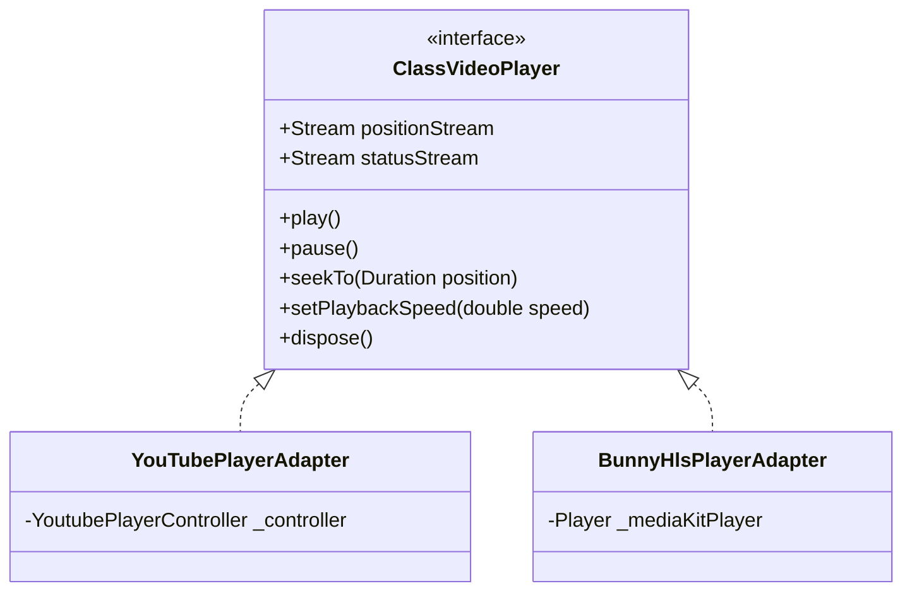
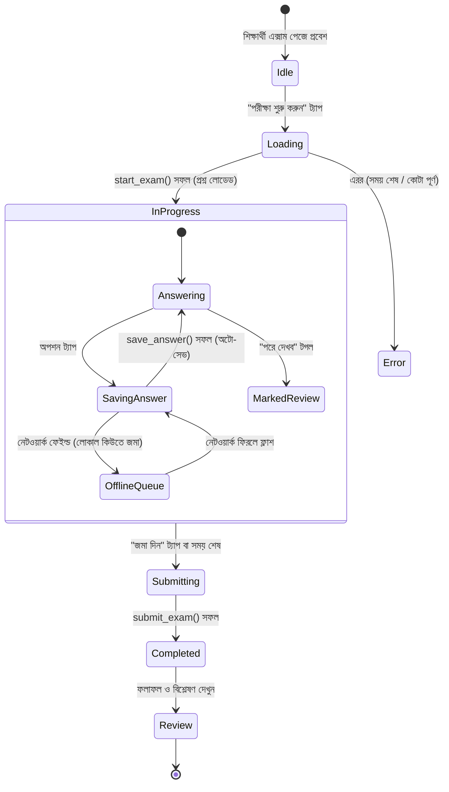

# 06 — Flutter Student App Architecture & Implementation Spec

> এই ডকুমেন্টে ClassRoom শিক্ষার্থী অ্যাপ্লিকেশনের (Flutter) সম্পূর্ণ সফটওয়্যার আর্কিটেকচার, স্টেট ম্যানেজমেন্ট, রাউটিং, ভিডিও প্লেয়ার অ্যাবস্ট্রাকশন, নেটিভ পিডিএফ ম্যানেজার, এক্সাম স্টেট মেশিন এবং স্ক্রিন-বাই-স্ক্রিন ইমপ্লিমেন্টেশন স্পেসিফিকেশন প্রদান করা হয়েছে।

---

## ১. আর্কিটেকচার ও টেক স্ট্যাক

- **টার্গেট ফ্রেমওয়ার্ক:** Flutter 3.24+ (Dart 3.5+) Stable
- **টার্গেট প্ল্যাটফর্ম:** Android (API 24+) এবং iOS (13.0+)
- **স্থাপত্য নকশা:** **Feature-First Clean Architecture** (Domain, Data, Presentation লেয়ারের সুস্পষ্ট বিভাজন)।
- **স্টেট ম্যানেজমেন্ট:** `flutter_riverpod` (Riverpod 2.5+ / 3.x) সাথে `riverpod_annotation` এবং কোড জেনারেশন।
- **রাউটিং:** `go_router` সাথে `StatefulShellRoute.indexedStack` (৪টি বটম ট্যাবের স্টেট অক্ষুণ্ণ রেখে নেভিগেশন) এবং অথেনটিকেশন রিডাইরেক্ট গার্ড।
- **ডাটা মডেলিং:** `freezed` এবং `json_serializable` (ইমিউটেবল মডেল ও টাইপ-সেফ JSON পার্সিং)।
- **লোকাল স্টোরেজ ও ক্যাশ:**
  - সংবেদনশীল ডেটা (Auth Session, Tokens): `flutter_secure_storage`।
  - অফলাইন কনটেন্ট মেটাডেটা ও ডাউনলোড ইনডেক্স: `hive_ce` অথবা `drift`।
- **সিকিউরিটি ও DRM:** `screen_protector` (সংবেদনশীল স্ক্রিনে স্ক্রিনশট ও স্ক্রিন রেকর্ডিং নিষ্ক্রিয়করণ)।

---

## ২. ফোল্ডার স্ট্রাকচার (Feature-First)

```
apps/mobile/
├── android/
├── ios/
├── assets/
│   ├── icons/               # SVG অ্যাপ ও বিষয় আইকন
│   ├── images/              # লোগো, প্লেসহোল্ডার
│   └── lottie/              # অ্যানিমেশন (পরীক্ষা উদযাপন, ইত্যাদি)
├── lib/
│   ├── core/
│   │   ├── config/          # Environment কনফিগারেশন, AppConstants
│   │   ├── network/         # Supabase ক্লায়েন্ট ইনিশিয়ালাইজেশন, Error Interceptor
│   │   ├── router/          # go_router কনফিগারেশন ও রিডাইরেক্ট গার্ডস
│   │   ├── security/       # ScreenProtector সার্ভিস, DRM গার্ডস
│   │   ├── theme/           # AppTheme, ColorTokens, TextTheme
│   │   └── utils/           # TimeFormatter, DriveUrlParser, LatexHelper
│   │
│   ├── shared/
│   │   ├── components/      # PrimaryButton, ShimmerSkeleton, EmptyStateWidget
│   │   ├── models/          # PaginationParams, ApiResponse
│   │   └── widgets/         # ClassRoomAppBar, SubjectBadge
│   │
│   ├── features/
│   │   ├── auth/            # লগইন, সাইনআপ, অনবোর্ডিং, সেশন প্রোভাইডার
│   │   │   ├── data/ (repositories, datasources)
│   │   │   ├── domain/ (models, auth_state)
│   │   │   └── presentation/ (screens, controllers)
│   │   │
│   │   ├── dashboard/       # হোম স্ক্রিন, স্ট্রিক, পরিসংখ্যান, নোটিশ
│   │   ├── subjects/        # বিষয় ও অধ্যায় তালিকা
│   │   ├── lessons/         # ক্লাস তালিকা, ভিডিও প্লেয়ার, প্রোগ্রেস ট্র্যাকার
│   │   ├── materials/       # লেকচার শিট, ড্রাইভ প্রিভিউ, ডাউনলোড ম্যানেজার, রিচ নোট
│   │   ├── exams/           # এক্সাম তালিকা, প্রশ্নব্যাংক, এক্সাম টেকিং স্টেট মেশিন, রেজাল্ট
│   │   ├── profile/         # ইউজার প্রোফাইল, সেটিংস, হিস্টোরি, ডাউনলোড লাইব্রেরি
│   │   └── notifications/   # পুশ নোটিফিকেশন রিসিভার ও তালিকা
│   │
│   └── main.dart            # এন্ট্রি পয়েন্ট, গ্লোবাল এরর হ্যান্ডলিং
├── l10n/                    # লোকালাইজেশন (app_bn.arb, app_en.arb)
├── pubspec.yaml
└── test/                    # ইউনিট, উইজেট ও মক টেস্ট (কোনো প্রোডাকশন ডেমো ডেটা নয়)
```

---

## ৩. `pubspec.yaml` ডিপেন্ডেন্সি তালিকা

```yaml
name: classroom
description: A modern student learning and examination app.
publish_to: 'none'
version: 1.0.0+1

environment:
  sdk: '>=3.5.0 <4.0.0'
  flutter: ">=3.24.0"

dependencies:
  flutter:
    sdk: flutter
  flutter_localizations:
    sdk: flutter

  # Backend & Network
  supabase_flutter: ^2.8.0
  dio: ^5.7.0
  connectivity_plus: ^6.1.0

  # State Management & Routing
  flutter_riverpod: ^2.6.1
  riverpod_annotation: ^2.6.1
  go_router: ^14.6.2

  # Data Modeling & Immutability
  freezed_annotation: ^2.4.4
  json_annotation: ^4.9.0

  # Security & Storage
  flutter_secure_storage: ^9.2.2
  hive_ce: ^2.0.0
  hive_ce_flutter: ^2.0.0
  path_provider: ^2.1.5
  screen_protector: ^1.5.0

  # Video & Media
  youtube_player_iframe: ^5.2.1
  media_kit: ^1.1.11
  media_kit_video: ^1.2.5

  # Document & Rendering
  pdfrx: ^1.0.95
  webview_flutter: ^4.10.0
  flutter_markdown: ^0.7.4
  flutter_math_fork: ^0.7.2

  # UI, Icons, Typography
  google_fonts: ^6.2.1
  cached_network_image: ^3.4.1
  shimmer: ^3.0.0
  lottie: ^3.1.3
  lucide_icons: ^0.3.0

  # Notifications & Device
  firebase_core: ^3.8.1
  firebase_messaging: ^15.1.6
  flutter_local_notifications: ^18.0.1
  google_sign_in: ^6.2.2
  package_info_plus: ^8.1.2
  device_info_plus: ^11.1.1
  intl: ^0.19.0
  share_plus: ^10.1.2
  url_launcher: ^6.3.1

dev_dependencies:
  flutter_test:
    sdk: flutter
  build_runner: ^2.4.13
  freezed: ^2.5.7
  json_serializable: ^6.8.0
  riverpod_generator: ^2.6.2
  mocktail: ^1.0.4

flutter:
  uses-material-design: true
  generate: true
  assets:
    - assets/icons/
    - assets/images/
    - assets/lottie/
```

---

## ৪. সিকিউর ক্লায়েন্ট কনফিগারেশন

### ৪.১ কম্পাইল-টাইম Environment Variables (`--dart-define-from-file`)
সিক্রেট বা কী কখনো সোর্স কোডে হার্ডকোড করা যাবে না। প্রোজেক্ট রুটে `env.json` (gitignored):
```json
{
  "SUPABASE_URL": "https://your-project.supabase.co",
  "SUPABASE_ANON_KEY": "eyJhbGciOiJIUzI1NiIsInR5cCI6IkpXVCJ9..."
}
```
রান করার কমান্ড:
```bash
flutter run --dart-define-from-file=env.json
```

### ৪.২ সিকিউর সেশন অ্যাডাপ্টার
ডিভাইস কিচেইনে টোকেন সংরক্ষণের জন্য Supabase `LocalStorage` ইমপ্লিমেন্টেশন:
```dart
import 'package:flutter_secure_storage/flutter_secure_storage.dart';
import 'package:supabase_flutter/supabase_flutter.dart';

class SecureLocalStorage extends LocalStorage {
  final _storage = const FlutterSecureStorage();

  @override
  Future<void> initialize() async {}

  @override
  Future<String?> accessToken() async => await _storage.read(key: supabasePersistSessionKey);

  @override
  Future<void> removePersistedSession() async => await _storage.delete(key: supabasePersistSessionKey);

  @override
  Future<void> persistSession(String persistSessionString) async {
    await _storage.write(key: supabasePersistSessionKey, value: persistSessionString);
  }

  @override
  Future<bool> hasAccessToken() async => await _storage.containsKey(key: supabasePersistSessionKey);
}
```

---

## ৫. ফ্রিজড ডাটা মডেলস (Data Models)

### ৫.১ লেসন মডেল (`LessonModel`)
```dart
import 'package:freezed_annotation/freezed_annotation.dart';

part 'lesson_model.freezed.dart';
part 'lesson_model.g.dart';

@freezed
class LessonModel with _$LessonModel {
  const factory LessonModel({
    required String id,
    @JsonKey(name: 'chapter_id') required String chapterId,
    required String title,
    String? description,
    @JsonKey(name: 'video_provider') required String videoProvider, // 'youtube' | 'bunny' | 'none'
    @JsonKey(name: 'video_ref') String? videoRef,
    @JsonKey(name: 'video_duration_sec') int? videoDurationSec,
    @JsonKey(name: 'thumbnail_url') String? thumbnailUrl,
    @JsonKey(name: 'instructor_name') String? instructorName,
    @JsonKey(name: 'sort_order') @Default(0) int sortOrder,
    @JsonKey(name: 'is_premium') @Default(false) bool isPremium,
    @JsonKey(name: 'is_published') @Default(false) bool isPublished,
  }) = _LessonModel;

  factory LessonModel.fromJson(Map<String, dynamic> json) => _$LessonModelFromJson(json);
}
```

### ৫.২ ম্যাটেরিয়াল মডেল (`MaterialModel`)
```dart
@freezed
class MaterialModel with _$MaterialModel {
  const factory MaterialModel({
    required String id,
    @JsonKey(name: 'lesson_id') required String lessonId,
    required String type, // 'lecture_sheet' | 'class_note' | 'other'
    required String source, // 'drive' | 'storage' | 'rich_text'
    required String title,
    @JsonKey(name: 'drive_file_id') String? driveFileId,
    @JsonKey(name: 'storage_path') String? storagePath,
    @JsonKey(name: 'content_md') String? contentMd,
    @JsonKey(name: 'file_size_bytes') int? fileSizeBytes,
    @JsonKey(name: 'page_count') int? pageCount,
    @JsonKey(name: 'allow_download') @Default(true) bool allowDownload,
  }) = _MaterialModel;

  factory MaterialModel.fromJson(Map<String, dynamic> json) => _$MaterialModelFromJson(json);
}
```

---

## ৬. রিপোজিটরি ও আরপিসি ইন্টিগ্রেশন

### ৬.১ রিপোজিটরি কোড স্নsnippet
```dart
class ExamRepository {
  final SupabaseClient _supabase;
  ExamRepository(this._supabase);

  // পরীক্ষা শুরু বা রিজ্যুম
  Future<ExamStartPayload> startExam(String examId) async {
    try {
      final response = await _supabase.rpc('start_exam', params: {'p_exam_id': examId});
      return ExamStartPayload.fromJson(response as Map<String, dynamic>);
    } on PostgrestException catch (e) {
      throw ExamException(mapPostgresErrorToBangla(e.message));
    }
  }

  // প্রতিটি উত্তর অটো-সেভ
  Future<void> saveAnswer({
    required String attemptId,
    required String questionId,
    required String? optionId,
  }) async {
    try {
      await _supabase.rpc('save_answer', params: {
        'p_attempt_id': attemptId,
        'p_question_id': questionId,
        'p_option_id': optionId,
      });
    } on PostgrestException catch (e) {
      throw ExamException(mapPostgresErrorToBangla(e.message));
    }
  }

  // পরীক্ষা সাবমিট
  Future<ExamResultModel> submitExam(String attemptId) async {
    try {
      final response = await _supabase.rpc('submit_exam', params: {'p_attempt_id': attemptId});
      return ExamResultModel.fromJson(response as Map<String, dynamic>);
    } on PostgrestException catch (e) {
      throw ExamException(mapPostgresErrorToBangla(e.message));
    }
  }
}
```

### ৬.২ বাংলা এরর ম্যাপিং ফাংশন
```dart
String mapPostgresErrorToBangla(String errorCode) {
  switch (errorCode) {
    case 'NOT_AUTHORIZED':
      return 'আপনার এই পরীক্ষাটি দেওয়ার অনুমতি নেই।';
    case 'EXAM_NOT_FOUND':
      return 'পরীক্ষাটি খুঁজে পাওয়া যায়নি।';
    case 'PREMIUM_REQUIRED':
      return 'এই পরীক্ষাটি শুধুমাত্র প্রিমিয়াম শিক্ষার্থীদের জন্য।';
    case 'EXAM_NOT_STARTED':
      return 'পরীক্ষাটি এখনো শুরু হয়নি। নির্ধারিত সময়ে আবার চেষ্টা করুন।';
    case 'EXAM_ENDED':
      return 'পরীক্ষার সময়সীমা শেষ হয়ে গেছে।';
    case 'MAX_ATTEMPTS_REACHED':
      return 'আপনি এই পরীক্ষার সর্বোচ্চ সুযোগ গ্রহণ করে ফেলেছেন।';
    case 'EXAM_HAS_NO_QUESTIONS':
      return 'এই পরীক্ষায় এখনো কোনো প্রশ্ন যুক্ত করা হয়নি।';
    case 'ATTEMPT_CLOSED':
    case 'TIME_UP':
      return 'পরীক্ষার সময় শেষ! আপনার উত্তরসমূহ জমা হয়েছে।';
    case 'INVALID_OPTION':
    case 'INVALID_QUESTION':
      return 'অবৈধ উত্তর নির্বাচন করা হয়েছে। অনুগ্রহ করে আবার চেষ্টা করুন।';
    default:
      return 'একটি অপ্রত্যাশিত ত্রুটি ঘটেছে। অনুগ্রহ করে ইন্টারনেট সংযোগ চেক করে আবার চেষ্টা করুন।';
  }
}
```

---

## ৭. ভিডিও প্লেয়ার অ্যাবস্ট্রাকশন (YouTube & Bunny Stream)

শিক্ষার্থীদের নিরবচ্ছিন্ন ভিডিও অভিজ্ঞতা দিতে একটি ইউনিফাইড ইন্টারফেস:



### প্রোগ্রেস ট্র্যাকিং নিয়মাবলী:
- ভিডিও চালু অবস্থায় প্রতি **১০ সেকেন্ড** পরপর ব্যাকগ্রাউন্ডে `update_lesson_progress` আরপিসি কল হবে:
  ```dart
  _timer = Timer.periodic(const Duration(seconds: 10), (_) {
    if (isPlaying) {
      ref.read(lessonProgressRepositoryProvider).updateProgress(
        lessonId: lesson.id,
        positionSec: currentPosition.inSeconds,
        deltaWatchedSec: 10,
      );
    }
  });
  ```
- ভিডিও পজ করলে বা ব্যাক বাটনে স্ক্রিন থেকে বের হলে সাথে সাথে ফাইনাল পজিশন আপডেট করা হবে।
- পরবর্তীতে ক্লাসটি আবার খুললে স্বয়ংক্রিয়ভাবে `last_position_sec` থেকে শুরু হবে।

---

## ৮. লেকচার শিট ও নেটিভ পিডিএফ ম্যানেজার (PDF & Drive)

1. **Google Drive প্রিভিউ ফ্লো:**
   - ড্রাইভের লিঙ্ক থেকে ফাইল আইডি এক্সট্র্যাক্ট করা হয়।
   - ডাউনলোড URL:
     `https://drive.usercontent.google.com/download?id=${fileId}&export=download&confirm=t`
   - অ্যাপ প্রথমে ফাইলটি অ্যাপ ক্যাশ ডিরেক্টরিতে নামিয়ে নেয় এবং **`pdfrx`** নেটিভ ক্যানভাসে রেন্ডার করে।
   - এতে পেজ জুম, স্মুথ স্ক্রলিং এবং টেক্সট সার্চ সমর্থন করে। ড্রাইভের ডাইরেক্ট ডাউনলোড কোনো কারণে ব্লকড থাকলে ফলব্যাক হিসেবে `webview_flutter` দিয়ে `https://drive.google.com/file/d/${fileId}/preview` রেন্ডার করা হয়।
2. **ডাউনলোড ও অফলাইন লাইব্রেরি:**
   - ব্যবহারকারী "ডাউনলোড" বাটনে চাপলে Dio দিয়ে ব্যাকগ্রাউন্ডে নামিয়ে `getApplicationDocumentsDirectory()/downloads/{material_id}.pdf` পাথে সেভ হয়।
   - ডাউনলোড সম্পন্ন হলে মেটাডেটা লোকাল Hive/Drift ডাটাবেসে সেভ হয়।
   - শিক্ষার্থী ইন্টারনেট ছাড়াও **প্রোফাইল -> ডাউনলোডসমূহ** থেকে শিটগুলো পড়তে পারবে।
   - অ্যাডমিন যদি `allow_download = false` রাখে, তবে অ্যাপে ডাউনলোড বাটনটি লুকানো থাকবে।

---

## ৯. এক্সাম টেকিং স্টেট মেশিন (Exam State Machine)



### সার্ভার অফসেট টাইমার লজিক:
```dart
class ExamTimerNotifier extends StateNotifier<Duration> {
  Timer? _ticker;

  void startTimer({required DateTime serverDeadline, required DateTime serverNow}) {
    // সার্ভার ও ডিভাইসের সময়ের পার্থক্য হিসাব
    final deviceNow = DateTime.now();
    final timeOffset = serverNow.difference(deviceNow);

    _ticker?.cancel();
    _ticker = Timer.periodic(const Duration(seconds: 1), (_) {
      final currentSynchronizedTime = DateTime.now().add(timeOffset);
      final remaining = serverDeadline.difference(currentSynchronizedTime);

      if (remaining.isNegative || remaining.inSeconds == 0) {
        state = Duration.zero;
        _ticker?.cancel();
        // সময় শেষ - স্বয়ংক্রিয় সাবমিট ট্রিগার
        onTimeExpired();
      } else {
        state = remaining;
      }
    });
  }

  @override
  void dispose() {
    _ticker?.cancel();
    super.dispose();
  }
}
```

---

## ১০. স্ক্রিন-বাই-স্ক্রিন স্পেসিফিকেশন টেবিল

| স্ক্রিন পাথ | রাউট নাম | ডেটা প্রোভাইডার / আরপিসি | UI স্টেটসমূহ | ব্যবহারকারীর প্রধান অ্যাকশন |
|---|---|---|---|---|
| `/` | `splash` | `appSettingsProvider` | Loading, ForceUpdateDialog | সেশন ও ভার্সন যাচাই |
| `/login` | `login` | `authControllerProvider` | Idle, Loading, Error | ইমেইল বা গুগলে সাইন-ইন |
| `/onboarding` | `onboarding`| `levelsListProvider` | Loaded, Submitting | স্তর ও শিক্ষাপ্রতিষ্ঠান নির্বাচন |
| `/dashboard` | `dashboard` | `get_my_dashboard()`, `announcements` | Shimmer, Data, Empty, Error | স্ট্রিক দেখা, Continue Watching ট্যাপ |
| `/subjects` | `subjects` | `subjectsListProvider(levelId)` | Shimmer, Grid, Empty | বিষয় নির্বাচন |
| `/chapters/:id`| `chapters` | `chaptersListProvider(subjectId)` | Shimmer, List, Empty | অধ্যায় নির্বাচন |
| `/lessons/:id` | `lessons` | `lessonsListProvider(chapterId)` | Shimmer, Box Cards, Empty | ক্লাসে প্রবেশ |
| `/lesson-detail/:id` | `lessonDetail` | `lessonDetailProvider`, `update_lesson_progress` | PlayerLoading, Playing, Error | ভিডিও প্লে, লেকচার শিট/নোট/কুইজে ট্যাপ |
| `/pdf-view/:id`| `pdfView` | `materialDetailProvider` | Downloading, Rendering, Error | জুম, স্ক্রোল, ডাউনলোড ট্যাপ |
| `/class-note/:id`| `classNote`| `materialDetailProvider` | Markdown/LaTeX Rendered | সমীকরণ ও রিচ নোট পাঠ |
| `/exams` | `exams` | `examsListProvider` | Filtered List, Empty | প্র্যাকটিস বা লাইভ পরীক্ষা নির্বাচন |
| `/exam-instruction/:id` | `examIntro` | `examDetailProvider` | Detail, Checking Attempts | নিয়মাবলী পড়ে "শুরু করুন" ট্যাপ |
| `/exam-taking/:id` | `examTaking`| `start_exam`, `save_answer`, `submit_exam` | Active, Submitting, TimeUp | অপশন নির্বাচন, প্যালেট নেভিগেশন |
| `/exam-result/:id` | `examResult`| `get_attempt_result` | Result Summary, Pass/Fail Badge | রিভিউ ও লিডারবোর্ডে ট্যাপ |
| `/leaderboard/:id` | `leaderboard`| `get_exam_leaderboard` | Top List, User Rank Highlight | সহপাঠীদের র‍্যাংক দেখা |
| `/profile` | `profile` | `userProfileProvider` | Loaded, Editing | ছবি আপডেট, ডাউনলোড লাইব্রেরি, লগআউট |

---

## ১১. প্লে স্টোর ও প্রোডাকশন বিল্ড চেকলিস্ট

1. **Android Permission (`AndroidManifest.xml`):**
   - `INTERNET` ও `ACCESS_NETWORK_STATE`।
   - ক্যামেরা বা স্টোরেজের অতিরিক্ত কোনো পারমিশন দরকার নেই (Scoped Storage ডিফল্ট)।
2. **প্রোটেকশন এনফোর্সমেন্ট:**
   - প্রোডাকশন মোডে `screen_protector.preventScreenshotOn()` কল সক্রিয় থাকা নিশ্চিত করা।
3. **Google Sign-In SHA-1:**
   - Google Play App Signing key এবং লোকাল debug.keystore উভয়েরই SHA-1 Supabase Google Auth সেকশনে কনফিগার করা।
4. **App Links / Deep Linking (`AndroidManifest.xml` & `Info.plist`):**
   - Scheme: `classroom://`
   - Host: `lesson`, `exam`
5. **ProGuard Rules:**
   - Supabase ও Freezed মডেলের জন্য প্রো proguard নিয়ম যুক্ত করা যাতে অবfuscation-এর পর JSON পার্সিং ভেঙে না যায়।

