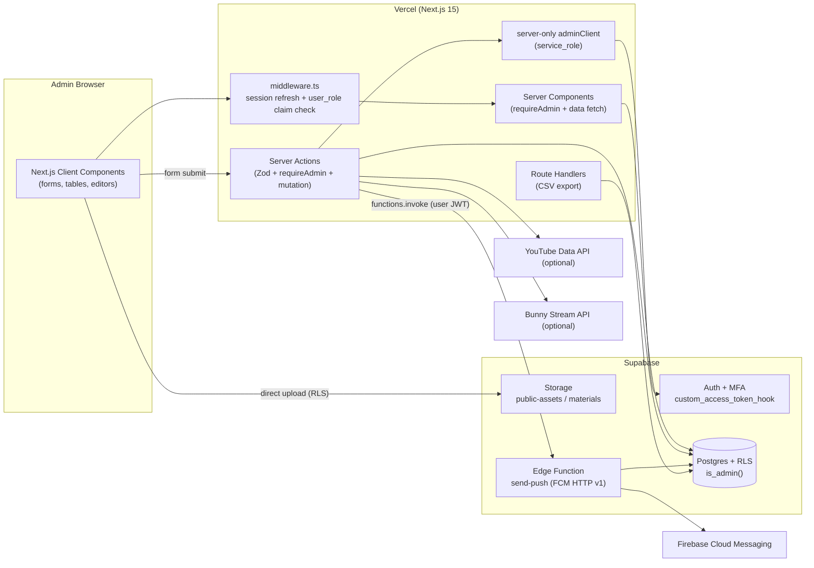

# 07 — Admin Panel (Next.js Admin Website)

> **ClassRoom Admin** — কনটেন্ট, প্রশ্ন ব্যাংক, পরীক্ষা, শিক্ষার্থী ও সিস্টেম ম্যানেজ করার জন্য আলাদা একটি **Next.js ওয়েবসাইট**।
> Admin কখনো Flutter অ্যাপের ভিতরে থাকবে না। Backend একটাই — Supabase (Postgres + RLS + Auth + Storage + Edge Functions)।
>
> **Source of truth:** [`docs/sql/schema.sql`](./sql/schema.sql)। এই ডকে ব্যবহৃত সব table / column / enum / RPC নাম ওই ফাইলের সাথে হুবহু মিলবে।

> [!IMPORTANT]
> **NO DEMO DATA নীতি:** Admin প্যানেলের কোথাও seed / fake / mock / placeholder কনটেন্ট থাকবে না। `supabase/seed.sql` থাকবে না (বা খালি থাকবে)। প্রতিটি লিস্ট/টেবিল পেজে **ডিজাইন করা Empty State** থাকবে (যেমন: *"এখনো কোনো সাবজেক্ট নেই — প্রথম সাবজেক্ট যোগ করুন"*)। প্রথম admin তৈরি হবে `schema.sql` এর শেষে দেওয়া **one-time SQL** দিয়ে (সেকশন ১৭)। Test fixture শুধু test code এর ভিতরে থাকবে, production DB তে কখনো না।

---

## সূচিপত্র

1. [Overview ও লক্ষ্য](#1-overview-ও-লক্ষ্য)
2. [Roles Matrix (admin vs super_admin)](#2-roles-matrix)
3. [Architecture](#3-architecture)
4. [Tech Stack](#4-tech-stack)
5. [Folder Structure](#5-folder-structure)
6. [Auth ও Security](#6-auth-ও-security)
7. [Schema Additions (প্রস্তাবিত migration)](#7-schema-additions-প্রস্তাবিত-migration)
8. [Page Specs](#8-page-specs)
9. [UI/UX Guidelines](#9-uiux-guidelines)
10. [Reusable Components](#10-reusable-components)
11. [Data Access Patterns](#11-data-access-patterns)
12. [Environment Variables](#12-environment-variables)
13. [Local Dev, Deploy, Testing](#13-local-dev-deploy-testing)
14. [Build Order (milestones) ও Acceptance Checklist](#14-build-order-ও-acceptance-checklist)

---

## 1. Overview ও লক্ষ্য

### 1.1 Admin প্যানেল কী করবে

| এলাকা | কাজ |
|---|---|
| **Content** | `levels` → `subjects` → `chapters` → `lessons` → `materials` হায়ারার্কি তৈরি, এডিট, রি-অর্ডার, publish/unpublish |
| **Question Bank** | chapter-ভিত্তিক MCQ (`questions` + `question_options`), Markdown + LaTeX, ছবি, ব্যাখ্যা, CSV/XLSX bulk import |
| **Exams** | `exams` তৈরি (scope: lesson / chapter / subject; mode: practice / live), প্রশ্ন বাছাই, রেজাল্ট ও অ্যানালিটিক্স |
| **Students** | শিক্ষার্থী খোঁজা, প্রোফাইল/প্রগ্রেস দেখা, block/unblock, CSV export |
| **Communication** | `announcements` এবং FCM push notification (Edge Function `send-push`) |
| **System** | `app_settings` (min app version, maintenance mode, feature flags), `audit_logs` viewer, admin/role ব্যবস্থাপনা |
| **Payment-ready** | `plans` / `subscriptions` — MVP তে feature flag (`feature.payments_enabled`) এর পিছনে লুকানো |

### 1.2 Design লক্ষ্য

1. **নিরাপত্তা আগে** — middleware (দ্রুত JWT claim চেক) + server-side `is_admin()` re-check + Postgres RLS — তিন স্তরের defense in depth।
2. **দ্রুত কনটেন্ট এন্ট্রি** — একজন শিক্ষক যেন ২ মিনিটে একটি লেসন (YouTube লিংক পেস্ট → thumbnail/duration অটো) + লেকচার শিট (Drive লিংক পেস্ট) যোগ করতে পারেন।
3. **ভুল কম** — Zod validation (client + server একই schema), DB constraint error এর বাংলা মেসেজ, destructive কাজে type-to-confirm।
4. **শূন্য থেকে শুরু** — প্রতিটি পেজ খালি অবস্থায় সুন্দর ও নির্দেশনামূলক।
5. **বাংলা-first UI** — সব লেবেল, টোস্ট, এরর বাংলায়; টেকনিক্যাল আইডেন্টিফায়ার ইংরেজিতে।

---

## 2. Roles Matrix

DB তে role থাকে `public.user_roles.role` (`app_role` enum: `student | admin | super_admin`)। JWT তে `user_role` custom claim যোগ করে `public.custom_access_token_hook`।

> [!NOTE]
> - **JWT claim** শুধু দ্রুত routing (middleware) এর জন্য — এটা stale হতে পারে (token refresh না হওয়া পর্যন্ত, ডিফল্ট ≤ ১ ঘণ্টা)।
> - **আসল authorization** হয় DB তে `public.is_admin()` / `public.is_super_admin()` দিয়ে, যা প্রতিবার `user_roles` টেবিল পড়ে। তাই role revoke করলে ডেটা access **সাথে সাথে** বন্ধ হয়।

| Feature / Action | `admin` | `super_admin` | DB-level enforcement |
|---|:---:|:---:|---|
| Dashboard দেখা | ✅ | ✅ | `admin_dashboard_stats()` → `is_admin()` |
| Levels / Subjects / Chapters / Lessons / Materials CRUD | ✅ | ✅ | RLS `admin_all_*` |
| Question Bank CRUD + Bulk import | ✅ | ✅ | RLS `admin_all_questions`, `admin_all_question_options` |
| Exams CRUD, stats, attempts দেখা, CSV export | ✅ | ✅ | RLS + `admin_exam_stats()` |
| Students দেখা, block/unblock, device remove | ✅ | ✅ | RLS `admin_all_profiles`, `admin_all_devices` |
| Student অ্যাকাউন্ট **hard delete** | ❌ | ✅ | service role (`auth.admin.deleteUser`) — server-only, action এ super_admin চেক |
| Announcements CRUD | ✅ | ✅ | RLS `admin_all_announcements` |
| Push notification পাঠানো | ✅ | ✅ | Edge Function `send-push` ভিতরে `is_admin()` চেক |
| App Settings **দেখা** | ✅ | ✅ | RLS `admin_all_app_settings` |
| App Settings **এডিট** (maintenance, versions, flags) | ❌ | ✅ | App-level (action এ চেক) + ঐচ্ছিক DB hardening (সেকশন ৭.৭) |
| Audit Logs দেখা | ✅ | ✅ | RLS `admin_read_audit` (শুধু SELECT; কেউ এডিট/ডিলিট করতে পারে না) |
| Admins & Roles পেজ, admin invite, role পরিবর্তন | ❌ | ✅ | RLS `super_admin_write_roles` |
| Plans / Subscriptions (flag on থাকলে) | ❌ (read-only) | ✅ | RLS `admin_all_plans` + app-level |

**নিয়ম:**
- নিজের role নিজে কমানো যাবে না, এবং **শেষ `super_admin` কে demote করা যাবে না** (server action এ চেক)।
- `student` role এর কেউ admin সাইটে লগইন করলে → `/forbidden` পেজ ("এই প্যানেল শুধু অ্যাডমিনদের জন্য") + sign-out বাটন।

---

## 3. Architecture



**মূল নীতি:**
- সব read/write হয় **লগইন করা admin এর নিজের JWT** দিয়ে (anon/publishable key + cookie session) → RLS প্রযোজ্য, এবং `audit_logs.actor_id` তে সঠিক admin এর `auth.uid()` বসে।
- `service_role` key **শুধু** সেই কাজে যেখানে Supabase Auth Admin API লাগে: admin invite, user ban/unban, user delete। এটা `lib/supabase/admin.ts` এ থাকবে, যার প্রথম লাইন `import 'server-only'`।
- Push notification পাঠানো Edge Function এর কাজ — FCM credentials Next.js এ কখনো থাকবে না।

---

## 4. Tech Stack

| স্তর | লাইব্রেরি | নোট |
|---|---|---|
| Framework | **Next.js 15** (App Router) + **React 19** + **TypeScript strict** | `"strict": true`, `"noUncheckedIndexedAccess": true` |
| Styling | **Tailwind CSS v4** + **shadcn/ui** + **lucide-react** | CSS variables দিয়ে design tokens (সেকশন ৯.২) |
| Supabase | **`@supabase/ssr`** + `@supabase/supabase-js` | Server client (RSC/Actions), browser client শুধু upload / realtime এ |
| Mutation | **Server Actions** + **Zod v4** | client ও server একই schema (`lib/validators/*`) |
| Forms | **React Hook Form** + `@hookform/resolvers/zod` | |
| Tables | **TanStack Table v8** | server-side pagination/sort/filter, state থাকে URL search params এ (`nuqs` সুপারিশকৃত) |
| Client cache | **TanStack Query v5** | শুধু যেখানে দরকার: ⌘K সার্চ, question picker, cascading select |
| Editor | Markdown editor (textarea + toolbar) + `react-markdown` + `remark-gfm` + `remark-math` + `rehype-katex` | Markdown-ই source of truth (Flutter অ্যাপ Markdown রেন্ডার করে) |
| Charts | **Recharts** | dashboard, exam stats |
| DnD | **dnd-kit** (`@dnd-kit/core`, `@dnd-kit/sortable`) | `sort_order` রি-অর্ডার |
| Import | **papaparse** (CSV) + **SheetJS `xlsx`** (XLSX) | browser এ parse → preview → server action |
| Toast | **sonner** | বাংলা মেসেজ |
| Theme | **next-themes** | light/dark/system |
| Fonts | `next/font/google` → **Hind Siliguri** (বাংলা) + **Inter** (ইংরেজি/সংখ্যা) | |
| Image | `browser-image-compression` | upload এর আগে WebP তে compress |
| Date | `date-fns` + `date-fns-tz` | সব সময় `Asia/Dhaka` টাইমজোনে দেখানো |
| Types | `supabase gen types typescript` → `types/database.types.ts` | |
| Test | **Vitest** + **Playwright** | local Supabase এর বিপরীতে E2E |
| Deploy | **Vercel** | |

> [!TIP]
> Markdown editor হিসেবে Tiptap না নিয়ে **plain Markdown + live preview** সুপারিশ করা হচ্ছে, কারণ DB তে Markdown (`lessons.description`, `materials.content_md`, `questions.body`) সংরক্ষিত হয় এবং Flutter অ্যাপ সেটা সরাসরি রেন্ডার করে। WYSIWYG → Markdown serialization এ LaTeX ভেঙে যাওয়ার ঝুঁকি থাকে।

---

## 5. Folder Structure

Admin একটি আলাদা repo/ফোল্ডার: `classroom-admin/`

```text
classroom-admin/
├── app/
│   ├── (auth)/                              # লগইন ছাড়া অ্যাক্সেসযোগ্য
│   │   ├── layout.tsx                       # centered card layout
│   │   ├── login/
│   │   │   ├── page.tsx                     # email + password
│   │   │   └── actions.ts                   # signIn (rate limited)
│   │   ├── mfa/
│   │   │   ├── page.tsx                     # TOTP challenge (aal1 → aal2)
│   │   │   └── enroll/page.tsx              # প্রথমবার TOTP সেটআপ (QR)
│   │   ├── auth/
│   │   │   ├── confirm/route.ts             # invite / recovery token_hash verify
│   │   │   └── set-password/page.tsx        # invite পাওয়া admin এর পাসওয়ার্ড সেট
│   │   └── forbidden/page.tsx               # non-admin লগইন করলে
│   │
│   ├── (dashboard)/                         # সব admin পেজ — layout এ requireAdmin()
│   │   ├── layout.tsx                       # AppShell: Sidebar + Topbar + Breadcrumbs + IdleGuard
│   │   ├── page.tsx                         # Dashboard
│   │   ├── loading.tsx                      # global skeleton
│   │   ├── error.tsx                        # বাংলা error boundary
│   │   ├── levels/
│   │   │   └── page.tsx                     # list + dialog form + reorder
│   │   ├── subjects/
│   │   │   ├── page.tsx                     # ?level=<id>
│   │   │   └── [subjectId]/page.tsx         # subject details + chapters list
│   │   ├── chapters/
│   │   │   └── [chapterId]/page.tsx         # chapter details + lessons list
│   │   ├── lessons/
│   │   │   ├── new/page.tsx                 # ?chapter=<id>
│   │   │   └── [lessonId]/
│   │   │       ├── page.tsx                 # tabs: বিস্তারিত | ম্যাটেরিয়াল | এক্সাম
│   │   │       └── materials/page.tsx       # (ঐচ্ছিক আলাদা রুট; ট্যাব হিসেবেও চলে)
│   │   ├── questions/
│   │   │   ├── page.tsx                     # Question bank list
│   │   │   ├── new/page.tsx
│   │   │   ├── [questionId]/page.tsx        # edit
│   │   │   └── import/page.tsx              # CSV/XLSX bulk import wizard
│   │   ├── exams/
│   │   │   ├── page.tsx
│   │   │   ├── new/page.tsx                 # wizard step 1–3 → draft তৈরি
│   │   │   └── [examId]/
│   │   │       ├── page.tsx                 # overview (redirect → edit বা stats)
│   │   │       ├── edit/page.tsx            # ?step=basic|scope|settings|questions|review
│   │   │       ├── stats/page.tsx
│   │   │       ├── attempts/page.tsx
│   │   │       ├── attempts/[attemptId]/page.tsx
│   │   │       └── export/route.ts          # GET → results CSV
│   │   ├── students/
│   │   │   ├── page.tsx
│   │   │   ├── [userId]/page.tsx
│   │   │   └── export/route.ts              # GET → students CSV
│   │   ├── admins/page.tsx                  # super_admin only
│   │   ├── announcements/
│   │   │   ├── page.tsx
│   │   │   ├── new/page.tsx
│   │   │   └── [announcementId]/page.tsx
│   │   ├── notifications/
│   │   │   ├── page.tsx                     # history
│   │   │   └── new/page.tsx                 # compose
│   │   ├── settings/page.tsx
│   │   ├── audit-logs/page.tsx
│   │   ├── plans/page.tsx                   # feature-flagged
│   │   └── subscriptions/page.tsx           # feature-flagged
│   │
│   ├── layout.tsx                           # <html lang="bn">, fonts, ThemeProvider, Toaster
│   ├── globals.css                          # Tailwind v4 + design tokens + KaTeX css import
│   ├── robots.ts                            # disallow all
│   └── not-found.tsx
│
├── actions/                                 # Server Actions (প্রতিটি ফাইলের শুরুতে 'use server')
│   ├── levels.ts
│   ├── subjects.ts
│   ├── chapters.ts
│   ├── lessons.ts                           # createLesson, updateLesson, togglePublish, deleteLesson
│   ├── materials.ts
│   ├── questions.ts                         # upsertQuestion, deleteQuestion, importQuestions
│   ├── exams.ts                             # createExamDraft, updateExam, setExamQuestions, cloneExam, publishExam
│   ├── students.ts                          # setBlocked, removeDevice, deleteStudent
│   ├── admins.ts                            # inviteAdmin, changeRole
│   ├── announcements.ts
│   ├── notifications.ts                     # sendPush → Edge Function
│   ├── settings.ts
│   ├── reorder.ts                           # admin_reorder RPC wrapper
│   └── media.ts                             # fetchYouTubeMeta, fetchBunnyMeta, checkDriveFile, getSignedMaterialUrl
│
├── components/
│   ├── ui/                                  # shadcn generated (button, dialog, form, input, ...)
│   ├── layout/                              # AppSidebar, Topbar, Breadcrumbs, UserMenu, CommandPalette, IdleGuard
│   ├── data-table/                          # DataTable, DataTableToolbar, DataTablePagination, column helpers
│   ├── common/                              # PageHeader, EmptyState, ConfirmDialog, StatusBadge, StatCard, ...
│   ├── inputs/                              # ImageUploader, PdfUploader, DriveLinkInput, YouTubeInput,
│   │                                        # BunnyVideoInput, ColorPicker, TagInput, CascadingSelect, DateTimePicker
│   ├── editor/                              # MarkdownEditor, MarkdownPreview (KaTeX)
│   ├── sortable/                            # SortableList
│   └── features/                            # পেজ-নির্দিষ্ট কম্পোনেন্ট
│       ├── lessons/  questions/  exams/  students/  ...
│
├── lib/
│   ├── supabase/
│   │   ├── server.ts                        # createClient() — RSC / Actions / Route Handlers
│   │   ├── client.ts                        # createBrowserClient() — শুধু upload / realtime
│   │   ├── middleware.ts                    # updateSession()
│   │   └── admin.ts                         # createAdminClient() — service_role, 'server-only'
│   ├── auth/
│   │   └── require-admin.ts                 # requireAdmin(), getAdminContext()
│   ├── validators/                          # Zod schemas (client+server shared)
│   │   ├── common.ts  level.ts  subject.ts  chapter.ts  lesson.ts  material.ts
│   │   ├── question.ts  question-import.ts  exam.ts  announcement.ts  push.ts  settings.ts
│   ├── media/
│   │   ├── youtube.ts                       # extractYouTubeId, parseIsoDuration, thumbnailUrl
│   │   ├── drive.ts                         # extractDriveFileId, drivePreviewUrl
│   │   └── bunny.ts                         # isBunnyGuid, bunnyEmbedUrl
│   ├── import/
│   │   ├── parse.ts                         # papaparse / xlsx → rows
│   │   └── validate.ts                      # row-level validation + duplicate detection
│   ├── errors.ts                            # mapDbError() → বাংলা মেসেজ
│   ├── action-result.ts                     # ActionResult<T> type + helpers
│   ├── search-params.ts                     # table URL state parser (Zod)
│   ├── settings.ts                          # SETTINGS_REGISTRY (key, type, default, is_public)
│   ├── format.ts                            # বাংলা সংখ্যা, তারিখ, duration ফরম্যাট
│   └── utils.ts                             # cn(), slugify()
│
├── types/
│   ├── database.types.ts                    # generated — হাতে এডিট নিষেধ
│   └── index.ts                             # Tables<'lessons'> ইত্যাদি alias
│
├── public/
│   └── templates/
│       └── question-import-template.xlsx    # শুধু header row (কোনো sample প্রশ্ন নয়)
│
├── tests/
│   ├── unit/                                # Vitest
│   ├── e2e/                                 # Playwright specs
│   ├── fixtures/                            # শুধু test এর CSV/ছবি (production এ কখনো যায় না)
│   └── setup/global-setup.ts                # local Supabase এ test user তৈরি
│
├── middleware.ts
├── next.config.ts                           # security headers, CSP, images
├── components.json                          # shadcn config
├── vitest.config.ts
├── playwright.config.ts
├── .env.example
└── package.json
```

> [!NOTE]
> Next.js 16 এ `middleware.ts` এর নাম `proxy.ts` হয়েছে। এই ডক Next.js 15 ধরে লেখা; আপগ্রেড করলে শুধু ফাইল/ফাংশনের নাম বদলাবে, লজিক একই।


---

## ৬. অথেনটিকেশন ও সিকিউরিটি ইমপ্লিমেন্টেশন

অ্যাডমিন প্যানেলে ক্লায়েন্ট-সাইড কোনো সিকিউরিটির ওপর নির্ভর করা হয় না। মাল্টি-লেয়ার সুরক্ষাব্যবস্থা (Defense-in-depth) নিশ্চিত করা হয়েছে:

### ৬.১ Next.js Middleware (`middleware.ts`)
প্রতিটি রিকোয়েস্টে ইউজারের সেশন রিফ্রেশ করা হয় এবং টোকেনের `user_role` ক্লেইম যাচাই করে অননুমোদিত অ্যাক্সেস ব্লক করা হয়:

```ts
// apps/admin/middleware.ts
import { createServerClient } from "@supabase/ssr";
import { NextResponse, type NextRequest } from "next/server";

export async function middleware(request: NextRequest) {
  let response = NextResponse.next({ request: { headers: request.headers } });

  const supabase = createServerClient(
    process.env.NEXT_PUBLIC_SUPABASE_URL!,
    process.env.NEXT_PUBLIC_SUPABASE_ANON_KEY!,
    {
      cookies: {
        getAll() { return request.cookies.getAll(); },
        setAll(cookiesToSet) {
          cookiesToSet.forEach(({ name, value, options }) => request.cookies.set(name, value));
          response = NextResponse.next({ request });
          cookiesToSet.forEach(({ name, value, options }) => response.cookies.set(name, value, options));
        },
      },
    }
  );

  const { data: { user } } = await supabase.auth.getUser();
  const isAuthRoute = request.nextUrl.pathname.startsWith("/login");

  if (!user && !isAuthRoute) {
    return NextResponse.redirect(new URL("/login", request.url));
  }

  if (user) {
    // JWT claim থেকে role যাচাই
    const { data: { session } } = await supabase.auth.getSession();
    const role = session?.user?.app_metadata?.user_role || "student";

    if (role === "student") {
      await supabase.auth.signOut();
      return NextResponse.redirect(new URL("/login?error=unauthorized", request.url));
    }

    if (isAuthRoute) {
      return NextResponse.redirect(new URL("/admin", request.url));
    }
  }

  return response;
}

export const config = {
  matcher: ["/((?!api|_next/static|_next/image|favicon.ico|templates).*)"],
};
```

### ৬.২ সার্ভার অ্যাকশন প্রোটেকশন হেল্পার (`requireAdmin`)
প্রতিটি Server Action-এর শুরুতে ডাটাবেস লেভেলে অ্যাডমিন পারমিশন পুনঃযাচাই করা হয়:

```ts
// apps/admin/lib/auth.ts
import "server-only";
import { createClient } from "@/lib/supabase/server";

export async function requireAdmin() {
  const supabase = await createClient();
  const { data: { user } } = await supabase.auth.getUser();
  if (!user) throw new Error("UNAUTHENTICATED");

  const { data: isAdmin } = await supabase.rpc("is_admin");
  if (!isAdmin) throw new Error("UNAUTHORIZED");

  return { user, supabase };
}

export async function requireSuperAdmin() {
  const { user, supabase } = await requireAdmin();
  const { data: isSuper } = await supabase.rpc("is_super_admin");
  if (!isSuper) throw new Error("FORBIDDEN_SUPER_ADMIN_REQUIRED");
  return { user, supabase };
}
```

### ৬.৩ উদাহরণ সার্ভার অ্যাকশন (`createLessonAction`)
```ts
// apps/admin/actions/lessons.ts
"use server";

import { requireAdmin } from "@/lib/auth";
import { revalidatePath } from "next/cache";
import { z } from "zod";

const createLessonSchema = z.object({
  chapterId: z.string().uuid(),
  title: z.string().min(1, "শিরোনাম আবশ্যক").max(200),
  description: z.string().optional(),
  videoProvider: z.enum(["youtube", "bunny", "none"]),
  videoRef: z.string().min(1, "ভিডিও রেফারেন্স আবশ্যক"),
  durationSec: z.number().int().nonnegative().optional(),
  thumbnailUrl: z.string().url().optional(),
  isPublished: z.boolean().default(false),
});

export async function createLessonAction(formData: unknown) {
  const { supabase, user } = await requireAdmin();
  const parsed = createLessonSchema.safeParse(formData);

  if (!parsed.success) {
    return { success: false, error: parsed.error.flatten().fieldErrors };
  }

  const { data, error } = await supabase.from("lessons").insert({
    chapter_id: parsed.data.chapterId,
    title: parsed.data.title,
    description: parsed.data.description,
    video_provider: parsed.data.videoProvider,
    video_ref: parsed.data.videoRef,
    video_duration_sec: parsed.data.durationSec,
    thumbnail_url: parsed.data.thumbnailUrl,
    is_published: parsed.data.isPublished,
    created_by: user.id,
  }).select("id").single();

  if (error) return { success: false, error: error.message };

  revalidatePath(`/admin/chapters/${parsed.data.chapterId}`);
  return { success: true, lessonId: data.id };
}
```

---

## ৭. পেজ-বাই-পেজ স্পেসিফিকেশন (Page Specifications)

### ৭.১ ড্যাশবোর্ড (`/admin`)
- **উদ্দেশ্য:** প্ল্যাটফর্মের সার্বিক পারফরম্যান্স পর্যবেক্ষণ।
- **ডাটা সোর্স:** `admin_dashboard_stats()` RPC।
- **উপাদান:**
  - মোট শিক্ষার্থী, ৭ দিনের নতুন শিক্ষার্থী, ৭ দিনের সক্রিয় শিক্ষার্থী এবং মোট ক্লাস ও পরীক্ষার কাউন্টার কার্ড।
  - গত ৩০ দিনের স্টুডেন্ট সাইনআপ বৃদ্ধির Recharts এরিয়া চার্ট (`signups_by_day`)।
  - সবচেয়ে জনপ্রিয় ৫টি ক্লাস ভিউয়ার সংখ্যাসহ তালিকা (`top_lessons`)।
  - সাম্প্রতিক অ্যাডমিন কাজের লাইভ ফিড (`audit_logs`)।

### ৭.২ স্তর ব্যবস্থাপনা (`/admin/levels`)
- **টেবিল কলাম:** ক্রম (`sort_order`), স্তর নাম (`name`), ইংরেজি নাম (`name_en`), স্লাগ (`slug`), প্রকাশিত স্ট্যাটাস (`is_published`), অ্যাকশন।
- **ফর্ম ভ্যালিডেশন:** স্লাগ অটো-জেনারেট হবে এবং ইউনিক হতে হবে।

### ৭.৩ বিষয় ও অধ্যায় ব্যবস্থাপনা (`/admin/subjects`)
- **ফিচার:**
  - স্তর নির্বাচন করে বিষয় ফিল্টার করা।
  - নতুন বিষয়ে আইকন আপলোড (Supabase Storage বাকেট: `public-assets/subjects/`)।
  - বিষয় অনুযায়ী HEX কালার পিকার (`color_hex`)।
  - বিষয়গুলোর ক্রম সাজাতে ড্র্যাগ-অ্যান্ড-ড্রপ রি-অর্ডারিং (`@dnd-kit/core`)।
- **অধ্যায় ড্রিল-ডাউন (`/admin/subjects/[id]/chapters`):**
  - বিষয়ের অধীনে অধ্যায় নম্বর ও নাম নির্ধারণ।
  - অধ্যায় অপ্রকাশিত করলে তার অধীনস্থ ক্লাস ও পরীক্ষা স্বয়ংক্রিয়ভাবে শিক্ষার্থীদের নিকট অপ্রকাশিত থাকবে (RLS cascaded check)।

### ৭.৪ ক্লাস বা লেসন ব্যবস্থাপনা (`/admin/lessons`)
- **ভিডিও প্রোভাইডার হ্যান্ডলিং:**
  - *YouTube:* শিক্ষক পুরো ভিডিও লিংক পেস্ট করতে পারবেন (যেমন: `https://youtu.be/dQw4w9WgXcQ` বা `https://www.youtube.com/watch?v=dQw4w9WgXcQ`)। ক্লায়েন্ট-সাইড Regex দিয়ে স্বয়ংক্রিয়ভাবে ভিডিও আইডি বের করা হবে:
    ```ts
    export function extractYouTubeId(url: string): string | null {
      const match = url.match(/(?:youtu\.be\/|youtube\.com\/(?:embed\/|v\/|watch\?v=|watch\?.+&v=))([\w-]{11})/);
      return match ? match[1] : null;
    }
    ```
  - ভিডিও আইডি বের হওয়ার সাথে সাথে থাম্বনেইল হিসেবে `https://img.youtube.com/vi/${id}/hqdefault.jpg` অটো-সেট হবে।
  - *Bunny Stream:* সরাসরি ভিডিও GUID এবং লাইব্রেরি আইডি ইনপুট।
- **রিচ টেক্সট বর্ণনা:** Markdown এডিটর ও সমীকরণের জন্য KaTeX লাইভ প্রিভিউ।

### ৭.৫ ম্যাটেরিয়াল ম্যানেজার (লেকচার শিট ও ক্লাস নোট)
- প্রতিটি লেসনের নিচে "ম্যাটেরিয়াল যোগ করুন" ট্যাব।
- **Google Drive লিঙ্ক ইনপুট:**
  - শিক্ষক গুগল ড্রাইভের শেয়ার লিঙ্ক দিলে নিচের Regex দিয়ে ফাইল আইডি এক্সট্র্যাক্ট করা হবে:
    ```ts
    export function extractDriveFileId(url: string): string | null {
      const match = url.match(/(?:\/file\/d\/|[?&]id=)([A-Za-z0-9_-]{10,})/);
      return match ? match[1] : null;
    }
    ```
  - ফর্মে সাথে সাথে আইফ্রেমের মাধ্যমে লাইভ প্রিভিউ প্রদর্শিত হবে (`https://drive.google.com/file/d/${fileId}/preview`), যা শিক্ষককে নিশ্চিত করবে ফাইলটি "Anyone with the link - Viewer" মুডে শেয়ার করা আছে কিনা।
- **ডাউনলোড পারমিশন টগল:** `allow_download` ট্রু/ফলস টগল।

### ৭.৬ প্রশ্নব্যাংক (Question Bank — `/admin/questions`)
- বিষয় ও অধ্যায় অনুযায়ী ফিল্টার সুবিধা।
- প্রশ্নের বডিতে Markdown ও LaTeX সমীকরণ (`$...$` বা `$$...$$`) ইনপুট।
- **চারটি অপশন (A, B, C, D):** শিক্ষকের জন্য রেডিও বাটন দিয়ে ঠিক একটি সঠিক উত্তর সিলেক্ট করা বাধ্যতামূলক (ডাটাবেসের Partial Unique Index দ্বারা সুরক্ষিত)।
- বিস্তারিত ব্যাখ্যা ও সমাধানের ছবি আপলোড।

### ৭.৭ এক্সাম ক্রিয়েশন উইজার্ড (`/admin/exams/new`)
একটি স্টেপ-বাই-স্টেপ উইজার্ড:
1. **স্টেপ ১ (মৌলিক তথ্য):** টাইটেল, পরীক্ষার পরিধি (`scope`: লেসন, অধ্যায় নাকি পুরো বিষয়), মোড (`practice` নাকি `live`)।
2. **স্টেপ ২ (নিয়মাবলী):** সময়কাল (মিনিটে), প্রতিটি প্রশ্নের মান, নেগেটিভ মার্কিং (default 0.25), পাস নম্বর %, সর্বোচ্চ কতবার দেওয়া যাবে (`max_attempts`), এবং উত্তর প্রকাশের নিয়ম (`answer_visibility`)।
3. **স্টেপ ৩ (প্রশ্ন বাছাই):**
   - সংশ্লিষ্ট অধ্যায়গুলোর কোশ্চেন ব্যাংক থেকে ম্যানুয়ালি টিক দিয়ে প্রশ্ন নির্বাচন।
   - অথবা "স্বয়ংক্রিয়ভাবে ২০টি প্রশ্ন র‍্যান্ডম নির্বাচন করুন" বাটন।
4. **স্টেপ ৪ (পর্যালোচনা ও প্রকাশ):** সম্পূর্ণ পরীক্ষার সেটিংস দেখে "পাবলিশ" করা।

> [!CAUTION]
> কোনো পরীক্ষায় শিক্ষার্থী একবার অংশগ্রহণ করে ফেললে (অর্থাৎ `exam_attempts` এ ডেটা থাকলে) সেই পরীক্ষার প্রশ্ন পরিবর্তন বা ডিলিট করা নিষিদ্ধ। সেক্ষেত্রে শিক্ষককে পরীক্ষাটি ক্লোন করে নতুন পরীক্ষা তৈরি করতে হবে।

### ৭.৮ এক্সাম অ্যানালিটিক্স ও ফলাফল (`/admin/exams/[id]/stats`)
- `admin_exam_stats(p_exam_id)` RPC দিয়ে রিয়েলটাইম পরিসংখ্যান:
  - মোট অংশগ্রহণকারী, গড় নম্বর, পাসের হার।
  - **প্রশ্নভিত্তিক নির্ভুলতার হার (Question Accuracy):** কোন প্রশ্নে শিক্ষার্থীরা সবচেয়ে বেশি ভুল করেছে তা শতাংশ আকারে দেখানো (যেমন: প্রশ্ন ০৫-এ মাত্র ১২% শিক্ষার্থী সঠিক উত্তর দিতে পেরেছে—যা শিক্ষককে দুর্বল টপিক চিহ্নিত করতে সাহায্য করে)।
  - অংশগ্রহণকারীদের সম্পূর্ণ ফলাফলের CSV ডাউনলোড।

### ৭.৯ বাল্ক প্রশ্ন ইমপোর্ট (Bulk Question Import)
- শিক্ষক যাতে এক ক্লিকে ৫০-১০০টি প্রশ্ন আপলোড করতে পারেন সেজন্য Excel / CSV ইমপোর্ট সুবিধা:
- **টেমপ্লেট কলাম:**
  `chapter_id, question_body, option_a, option_b, option_c, option_d, correct_option (A/B/C/D), explanation, difficulty, tags`
- **প্রিভিউ ও ভ্যালিডেশন টেবিল:**
  ফাইল ড্রপ করার পর ক্লায়েন্ট সাইডে `xlsx` (SheetJS) দিয়ে পার্স করে একটি প্রিভিউ গ্রিড দেখানো হবে। কোনো সারিতে ভুল থাকলে (যেমন সঠিক উত্তর মিসিং বা অপশন ফাঁকা) সারিটি লাল রঙে হাইলাইট হবে এবং কোন কলামে ভুল তা নোটিফিকেশনে বলে দেবে।
- সমস্ত ভুল সমাধান হলে "ইমপোর্ট করুন" চাপলে একটি ডেটাবেস ট্রানজ্যাকশনে সমস্ত প্রশ্ন সংরক্ষিত হবে।

### ৭.১০ শিক্ষার্থী পর্যবেক্ষণ (`/admin/students`)
- শিক্ষার্থীদের নাম, ইমেইল, কলেজ ও রেজিস্ট্রেশনের তারিখ সহ তালিকা।
- কোনো শিক্ষার্থী অসদুপায় অবলম্বন করলে তাকে **ব্লক (Block)** করার টগল বাটন (`profiles.is_blocked = true`)। ব্লক করা শিক্ষার্থী কোনো কনটেন্ট দেখতে পারবে না।

### ৭.১১ অডিট লগস (`/admin/audit`)
- অ্যাডমিনদের কাজের সম্পূর্ণ হিস্টোরি।
- কোন অ্যাডমিন, কোন সময়ে, কোন টেবিলের কোন রেকর্ডটি ডিলিট বা এডিট করেছেন তা JSON Diff (Before vs After) আকারে দেখার টেবিল।

---

## ৮. এনভায়রনমেন্ট ভেরিয়েবল চেকলিস্ট

অ্যাডমিন প্যানেল পরিচালনার জন্য `.env.local` কনফিগারেশন:

```env
# পাবলিক ক্লায়েন্ট ভেরিয়েবল (ব্রাউজারে এক্সপোজড)
NEXT_PUBLIC_SUPABASE_URL=https://your-project.supabase.co
NEXT_PUBLIC_SUPABASE_ANON_KEY=eyJhbGciOiJIUzI1NiIsInR5cCI6IkpXVCJ9...
NEXT_PUBLIC_APP_URL=https://admin.yourdomain.com

# সার্ভার-অনলি সিক্রেট ভেরিয়েবল (ব্রাউজারে কখনোই যাবে না)
SUPABASE_SERVICE_ROLE_KEY=eyJhbGciOiJIUzI1NiIsInR5cCI6IkpXVCJ9...

# ঐচ্ছিক ইন্টিগ্রেশন
YOUTUBE_API_KEY=AIzaSy...
```

---

## ৯. ডিপ্লয়মেন্ট গাইড (Vercel)

1. গিট রিপোজিটরি Vercel-এ কানেক্ট করুন।
2. Root Directory হিসেবে `apps/admin` নির্বাচন করুন।
3. Framework Preset: **Next.js**।
4. Environment Variables সেকশনে উপরের ভেরিয়েবলগুলো যুক্ত করুন।
5. **Deploy** বাটনে চাপুন। বিল্ড সফল হলে অ্যাডমিন ডোমেইনে প্রবেশ করে প্রথম সুপার অ্যাডমিন দিয়ে লগইন করুন।
