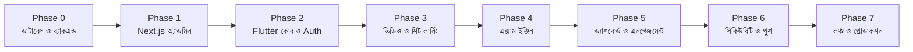

# 08 — Implementation Roadmap & Execution Milestones

> এই ডকুমেন্টে ClassRoom প্ল্যাটফর্মটি ধাপে ধাপে তৈরির জন্য বিস্তারিত মাইলস্টোন, টাস্ক ব্রেকডাউন, টেস্টিং স্ট্র্যাটেজি এবং প্রোডাকশন ডিপ্লয়মেন্ট চেকলিস্ট প্রদান করা হয়েছে।

---

## ১. বাস্তবায়ন পর্যায়ক্রম (Phased Roadmap Overview)

---

## ২. বিস্তারিত ফেজ ব্রেকডাউন (Task-by-Task Breakdown)

### ফেজ ০: ডাটাবেস ও ক্লাউড ব্যাকএন্ড সেটআপ
- [ ] **টাস্ক ০.১:** Supabase ক্লাউডে নতুন প্রজেক্ট তৈরি (Singapore রিজিয়ন নির্বাচন করুন)।
- [ ] **টাস্ক ০.২:** [`docs/sql/schema.sql`](sql/schema.sql) ফাইলটি Supabase SQL Editor-এ রান করে সমস্ত টেবিল, RLS এবং আরপিসি কার্যকর করা।
- [ ] **টাস্ক ০.৩:** Supabase Dashboard -> Authentication -> Hooks-এ গিয়ে **Custom Access Token (JWT)** হুক হিসেবে `public.custom_access_token_hook` এনাবল করা।
- [ ] **টাস্ক ০.৪:** প্রথম সুপার অ্যাডমিন ইউজার তৈরি করা (ম্যানুয়াল সাইনআপ ও SQL আপডেট দিয়ে রোল পরিবর্তন)।
- [ ] **টাস্ক ০.৫:** `public-assets` ও `materials` স্টোরেজ বাকেটের RLS যাচাই করা।

---

### ফেজ ১: Next.js অ্যাডমিন প্যানেল তৈরি (ওয়েবসাইট)
- [ ] **টাস্ক ১.১:** Next.js 15 App Router প্রজেক্ট ইনিশিয়ালাইজেশন সাথে Tailwind CSS ও shadcn/ui।
- [ ] **টাস্ক ১.২:** `@supabase/ssr` দিয়ে ক্লায়েন্ট ও সার্ভার অ্যাডাপ্টার তৈরি এবং `middleware.ts` দিয়ে রুট প্রোটেকশন (নন-অ্যাডমিন ব্লক)।
- [ ] **টাস্ক ১.৩:** লেভেল, বিষয় ও অধ্যায় ব্যবস্থাপনা (ড্র্যাগ-অ্যান্ড-ড্রপ রি-অর্ডারিং ও কালার পিকার সহ)।
- [ ] **টাস্ক ১.৪:** লেসন ক্রিয়েটর (YouTube লিঙ্ক পেস্ট করলে আইডি ও থাম্বনেইল স্বয়ংক্রিয় নিষ্কাশন, Bunny GUID ইনপুট)।
- [ ] **টাস্ক ১.৫:** ম্যাটেরিয়াল ম্যানেজার (গুগল ড্রাইভ লিঙ্ক ভ্যালিডেশন ও লাইভ প্রিভিউ আইফ্রেম)।
- [ ] **টাস্ক ১.৬:** কোশ্চেন ব্যাংক ও বাল্ক এক্সেল ইমপোর্ট (টেমপ্লেট ডাউনলোড, প্রিভিউ টেবিল, ভুল শনাক্তকরণ)।
- [ ] **টাস্ক ১.৭:** এক্সাম উইজার্ড (সেটিংস, সময়সীমা, প্রশ্ন বাছাই ও অ্যানালিটিক্স ভিউ)।
- [ ] **টাস্ক ১.৮:** অডিট লগস ভিউয়ার ও স্টুডেন্ট ব্লক/আনব্লক ম্যানেজমেন্ট।
- [ ] **টাস্ক ১.৯:** Vercel-এ অ্যাডমিন প্যানেল ডিপ্লয় করা (`admin.yourdomain.com`)।

---

### ফেজ ২: Flutter স্টুডেন্ট অ্যাপের ভিত্তি ও অথেনটিকেশন
- [ ] **টাস্ক ২.১:** Flutter প্রজেক্ট তৈরি ও [`docs/06-FLUTTER-APP.md`](06-FLUTTER-APP.md) অনুযায়ী `pubspec.yaml` ডিপেন্ডেন্সি ইনস্টলেশন।
- [ ] **টাস্ক ২.২:** থিম সিস্টেম ইমপ্লিমেন্টেশন ([`docs/05-DESIGN-SYSTEM.md`](05-DESIGN-SYSTEM.md) এর কালার টোকেন ও Hind Siliguri ফন্ট)।
- [ ] **টাস্ক ২.৩:** `flutter_secure_storage` দিয়ে Supabase Auth ইন্টিগ্রেশন (Email + Password এবং Google Sign-In)।
- [ ] **টাস্ক ২.৪:** Onboarding ফ্লো (ডাটাবেস থেকে লেভেল লিস্ট ফেচ করে প্রোফাইল আপডেট)।
- [ ] **টাস্ক ২.৫:** `go_router` দিয়ে StatefulShellRoute সেটআপ (ড্যাশবোর্ড, বিষয়, পরীক্ষা, প্রোফাইল)।
- [ ] **টাস্ক ২.৬:** গ্লোবাল এরর হ্যান্ডলার ও এম্পটি স্টেট উইজেট (নো ডেমো ডাটা রুলস এনফোর্সড)।

---

### ফেজ ৩: কনটেন্ট কনজাম্পশন (ভিডিও, লেকচার শিট ও ক্লাস নোট)
- [ ] **টাস্ক ৩.১:** বিষয় গ্রিড (`SubjectCard`) ও অধ্যায় তালিকা (`ChapterTile`) স্ক্রিন।
- [ ] **টাস্ক ৩.২:** অধ্যায়ের ভেতরে বক্স কার্ড আকারে ক্লাসের তালিকা (`LessonCard`) প্রদর্শন।
- [ ] **টাস্ক ৩.৩:** ইউনিফাইড ভিডিও প্লেয়ার (YouTube Unlisted এবং Bunny HLS)।
- [ ] **টাস্ক ৩.৪:** ক্লাসের নিচে ৩টি সহায়ক কার্ড: লেকচার শিট, পরীক্ষা ও ক্লাস নোট।
- [ ] **টাস্ক ৩.৫:** ভিডিও প্রোগ্রেস অটো-সেভ (`update_lesson_progress`) এবং রেজিউম প্লেব্যাক।
- [ ] **টাস্ক ৩.৬:** গুগল ড্রাইভ নেটিভ পিডিএফ ভিউয়ার (`pdfrx`) এবং ফলব্যাক ওয়েবভিউ।
- [ ] **টাস্ক ৩.৭:** অফলাইন পিডিএফ ডাউনলোড ম্যানেজার (Dio প্রোগ্রেস বার ও লোকাল স্টোরেজ)।
- [ ] **টাস্ক ৩.৮:** ক্লাস লেকচার নোট রেন্ডারার (`flutter_markdown` + KaTeX সমীকরণ)।

---

### ফেজ ৪: সার্ভার-সাইড এক্সাম ইঞ্জিন
- [ ] **টাস্ক ৪.১:** এক্সাম ট্যাব (বিষয় ও অধ্যায় সিলেক্ট করে প্র্যাকটিস ও লাইভ পরীক্ষার তালিকা)।
- [ ] **টাস্ক ৪.২:** পরীক্ষা শুরু করার পূর্বে নিয়মাবলী ও সতর্কবার্তা স্ক্রিন।
- [ ] **টাস্ক ৪.৩:** `start_exam` আরপিসি কল করে প্রশ্ন লোড ও শাফল অর্ডার কার্যকর করা।
- [ ] **টাস্ক ৪.৪:** সার্ভার-সিঙ্কড টাইমার উইজেট (ডিভাইসের সময় পরিবর্তন করলেও সময়ের হিসাব সুরক্ষিত)।
- [ ] **টাস্ক ৪.৫:** অপশন সিলেক্ট করার সাথে সাথে অটো-সেভ (`save_answer`) ও অফলাইন কিউ ফলব্যাক।
- [ ] **টাস্ক ৪.৬:** প্রশ্ন প্যালেট ড্রয়ার (উত্তর দেওয়া, বাকি থাকা এবং 'পরে দেখব' চিহ্নিত প্রশ্ন)।
- [ ] **টাস্ক ৪.৭:** পরীক্ষা সাবমিট ও ফলাফল বিশ্লেষণ (স্কোর, পাস/ফেল, নেগেটিভ মার্কিং হিসাব)।
- [ ] **টাস্ক ৪.৮:** উত্তরমালার বিস্তারিত রিভিউ (ব্যাখ্যা ও ছবি সহ) এবং মেধা তালিকা (Leaderboard)।

---

### ফেজ ৫: স্টুডেন্ট এনগেজমেন্ট ও ড্যাশবোর্ড
- [ ] **টাস্ক ৫.১:** ড্যাশবোর্ডে স্টুডেন্টের স্ট্রিক ও পড়ার পরিসংখ্যান কার্ড (`get_my_dashboard()`)।
- [ ] **টাস্ক ৫.২:** "Continue Watching" হরাইজন্টাল স্ক্রোল কার্ড।
- [ ] **টাস্ক ৫.৩:** নোটিশ বোর্ড ক্যারোসেল (Announcements)।
- [ ] **টাস্ক ৫.৪:** দুর্বল অধ্যায় চিহ্নিতকরণ সাজেশন কার্ড (`get_my_weak_chapters`)।
- [ ] **টাস্ক ৫.৫:** প্রোফাইল এডিট, লেভেল পরিবর্তন, বুকমার্কস এবং থিম পরিবর্তন (Light/Dark/System)।

---

### ফেজ ৬: সিকিউরিটি গার্ডস ও পুশ নোটিফিকেশন
- [ ] **টাস্ক ৬.১:** `screen_protector` ইন্টিগ্রেশন (ভিডিও, পিডিএফ ও পরীক্ষা স্ক্রিনে স্ক্রিনশট ও রেকর্ডিং ব্লক)।
- [ ] **টাস্ক ৬.২:** Firebase Cloud Messaging (FCM) সেটআপ ও `devices` টেবিলে টোকেন রেজিস্ট্রেশন।
- [ ] **টাস্ক ৬.৩:** Supabase Edge Function `send-push` এবং `bunny-signed-url` ডিপ্লয় করা।
- [ ] **টাস্ক ৬.৪:** অ্যাপ ভার্সন কন্ট্রোল ও মেইনটেন্যান্স চেক (`app_settings` আরপিসি)।
- [ ] **টাস্ক ৬.৫:** Sentry ক্র্যাশ রিপোর্টিং ইন্টিগ্রেশন।

---

### ফেজ ৭: টেস্টিং, প্লে স্টোর রিলিজ ও প্রোডাকশন লঞ্চ
- [ ] **টাস্ক ৭.১:** সম্পূর্ণ প্ল্যাটফর্মের অ্যান্ড-টু-অ্যান্ড ভেরিফিকেশন (অ্যাডমিনে কনটেন্ট যোগ -> অ্যাপে লোড -> পরীক্ষা সম্পন্ন -> অ্যানালিটিক্স)।
- [ ] **টাস্ক ৭.২:** ৫,০০০ লাইভ স্টুডেন্ট লোড টেস্টিং (k6 স্ক্রিপ্ট দিয়ে আরপিসি স্ট্রেস টেস্ট)।
- [ ] **টাস্ক ৭.৩:** Android App Bundle (`.aab`) বিল্ড ও গুগল প্লে কনসোলে ইন্টারনাল টেস্টিং রিলিজ।
- [ ] **টাস্ক ৭.৪:** গুগল প্লে স্টোর পলিসি ও ডেটা সেফটি ফর্ম পূরণ (অ্যাকাউন্ট ডিলিট অপশন নিশ্চিতকরণ)।
- [ ] **টাস্ক ৭.৫:** প্রোডাকশন পাবলিক রিলিজ! 🎉

---

## ৩. প্রোডাকশন লঞ্চ ও ভেরিফিকেশন চেকলিস্ট

| চেকলিস্ট আইটেম | স্ট্যাটাস | দায়িত্বপ্রাপ্ত |
|---|---|---|
| ডাটাবেসে কোনো ডামি/টেস্ট ডেটা অবশিষ্ট নেই | [ ] | Backend Lead |
| `SUPABASE_SERVICE_ROLE_KEY` কোথাও ক্লায়েন্ট বান্ডেলে এক্সপোজড নয় | [ ] | Security Lead |
| অ্যাডমিন প্যানেলে নন-অ্যাডমিন প্রবেশ ব্লকড | [ ] | Web Lead |
| পরীক্ষার প্রশ্নপত্রে সঠিক উত্তর নেটওয়ার্ক ইন্সপেক্টরে ফাঁসের সুযোগ নেই | [ ] | Exam Engine QA |
| ডিভাইস ঘড়ি পেছানোর মাধ্যমে পরীক্ষার সময় বাড়ানো যায় না | [ ] | Mobile QA |
| ভিডিও এবং পিডিএফ স্ক্রিনে স্ক্রিনশট কালো আসে | [ ] | Mobile Lead |
| গুগল ড্রাইভের পিডিএফ প্রিভিউ ও ডাউনলোড সঠিকভাবে কাজ করছে | [ ] | Media QA |
| অ্যাপের সাইজ ৩০ মেগাবাইটের নিচে রয়েছে | [ ] | Release Engineer |

